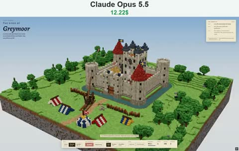

[← 返回图库](../browse/interactive.md) · [English](2114295486299664582.en.md)

# 投石机摧毁体素城堡

**[Vib3Coded · @vib3coded](https://x.com/vib3coded)** · 交互演示 · 18s

> 发现池 · 来源已核对，编目资料待完善。

**[▶ 打开画廊播放](https://guanmo-ai.github.io/awesome-ai-motion/#case-2114295486299664582)** · [作者原帖](https://x.com/vib3coded/status/2114295486299664582)

点击封面打开画廊播放。

投石机向城堡发射弹丸，墙体碎裂、残骸与护城河构成可破坏的微缩场景。

未取得作者公开提示词。 [查看作者原帖](https://x.com/vib3coded/status/2114295486299664582)

收藏 24 · 点赞 82 · 浏览 2,664

## 来源记录

- 作品原帖: [@vib3coded](https://x.com/vib3coded/status/2114295486299664582) · 2026-10-25T09:58:20+00:00
- 模型归因: Claude Opus 5.5 · [作者说明](https://x.com/vib3coded/status/2114295486299664582)
- 提示词查阅记录: [作者原帖](https://x.com/vib3coded/status/2114295486299664582) · 2026-10-26 06:34 UTC
- 封面来源: [原帖封面来源](https://x.com/vib3coded/status/2114295486299664582) · 3.6s
- 互动快照: [X 原帖](https://x.com/vib3coded/status/2114295486299664582) · 2026-10-26 06:34 UTC
- 画廊原视频: [原帖媒体记录](https://x.com/vib3coded/status/2114295486299664582) · 2026-10-26 06:34 UTC · 已核对原帖媒体对应与媒体响应；外部引用，不重新上传

模型依据来自作者自述，未独立重跑提示词，也未对音画作统一质量评级。视频引用作者原帖媒体，未由本站重新上传，转载许可未确认。
