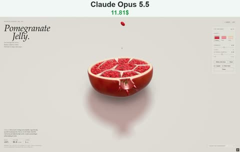

[← Back to gallery](../browse/motion.en.md) · [简体中文](2114311516698886225.md)

# Squishy Pomegranate and Scattering Seeds

**[NinjaCodex · @N1njaCodex](https://x.com/N1njaCodex)** · Motion design · 16s

> Discovery pool · Source verified; catalog details being completed.

**[▶ Open gallery to play](https://guanmo-ai.github.io/awesome-ai-motion/?lang=en#case-2114311516698886225)** · [Original post](https://x.com/N1njaCodex/status/2114311516698886225)

Click the cover to open the gallery and play.

A pomegranate wobbles and springs back while seeds pop out and scatter.

No public prompt has been verified. [View the original post](https://x.com/N1njaCodex/status/2114311516698886225)

Bookmarks — · Likes — · Views —

## Source record

- Original post: [@N1njaCodex](https://x.com/N1njaCodex/status/2114311516698886225) · 2026-10-25T11:02:02+00:00
- Model attribution: Claude Opus 5.5 · [Creator’s statement](https://x.com/N1njaCodex/status/2114311516698886225)
- Prompt lookup: [Creator post](https://x.com/N1njaCodex/status/2114311516698886225) · 2026-11-03 09:18 UTC
- Cover source: [Original cover source](https://x.com/N1njaCodex/status/2114311516698886225) · 3.21s
- Metrics snapshot: [Original X post](https://x.com/N1njaCodex/status/2114311516698886225) · 2026-11-03 08:38 UTC
- Gallery video source: [Original post media record](https://x.com/N1njaCodex/status/2114311516698886225) · 2026-11-03 09:18 UTC · Post/media correspondence and media response checked; external reference, no re-upload

Model attribution is based on creator statements. Prompts have not been independently rerun; sound and visuals have not received a uniform quality rating. Videos reference original post media, not our uploads; redistribution permission has not been verified.
