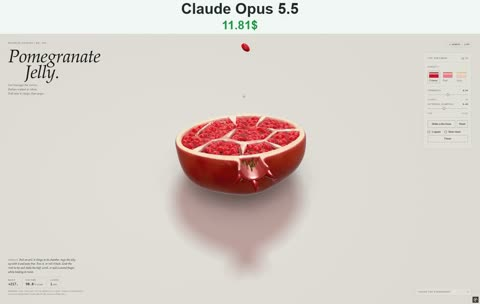

[← 返回图库](../browse/motion.md) · [English](2114311516698886225.en.md)

# 果冻石榴的弹性与籽粒散落

**[NinjaCodex · @N1njaCodex](https://x.com/N1njaCodex)** · 短动效 · 16s

> 发现池 · 来源已核对，编目资料待完善。

**[▶ 打开画廊播放](https://guanmo-ai.github.io/awesome-ai-motion/#case-2114311516698886225)** · [作者原帖](https://x.com/N1njaCodex/status/2114311516698886225)

点击封面打开画廊播放。

石榴在摇动中变形回弹，籽粒弹出并散落在桌面。

未取得作者公开提示词。 [查看作者原帖](https://x.com/N1njaCodex/status/2114311516698886225)

收藏 — · 点赞 — · 浏览 —

## 来源记录

- 作品原帖: [@N1njaCodex](https://x.com/N1njaCodex/status/2114311516698886225) · 2026-10-25T11:02:02+00:00
- 模型归因: Claude Opus 5.5 · [作者说明](https://x.com/N1njaCodex/status/2114311516698886225)
- 提示词查阅记录: [作者原帖](https://x.com/N1njaCodex/status/2114311516698886225) · 2026-11-03 09:18 UTC
- 封面来源: [原帖封面来源](https://x.com/N1njaCodex/status/2114311516698886225) · 3.21s
- 互动快照: [X 原帖](https://x.com/N1njaCodex/status/2114311516698886225) · 2026-11-03 08:38 UTC
- 画廊原视频: [原帖媒体记录](https://x.com/N1njaCodex/status/2114311516698886225) · 2026-11-03 09:18 UTC · 已核对原帖媒体对应与媒体响应；外部引用，不重新上传

模型依据来自作者自述，未独立重跑提示词，也未对音画作统一质量评级。视频引用作者原帖媒体，未由本站重新上传，转载许可未确认。
