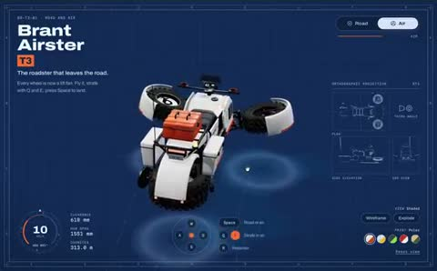

[← 返回图库](../browse/interactive.md) · [English](2114377433369739331.en.md)

# 从道路驶向天空的概念摩托

**[The Bugged Dev · @thebuggeddev](https://x.com/thebuggeddev)** · 交互演示 · 58s

> 发现池 · 来源已核对，编目资料待完善。

**[▶ 打开画廊播放](https://guanmo-ai.github.io/awesome-ai-motion/#case-2114377433369739331)** · [作者原帖](https://x.com/thebuggeddev/status/2114377433369739331)

点击封面打开画廊播放。

[飞行摩托的交互演示](https://brant-airster.wasmer.app/)

轮组与旋翼在白色概念载具上展开重组，以结构变化表现驾驶和飞行两种状态。

## 源码与网页

- **公开网页**：[飞行摩托的交互演示](https://brant-airster.wasmer.app/)
  [链接出处](https://x.com/thebuggeddev/status/2114377433369739331) · 链接核对 2026-10-26 06:26 UTC

未取得作者公开提示词。 [查看作者原帖](https://x.com/thebuggeddev/status/2114377433369739331)

收藏 125 · 点赞 203 · 浏览 8,092

## 来源记录

- 作品原帖: [@thebuggeddev](https://x.com/thebuggeddev/status/2114377433369739331) · 2026-10-25T15:23:58+00:00
- 模型归因: Claude Opus 5.5 · [作者说明](https://x.com/thebuggeddev/status/2114377433369739331)
- 提示词查阅记录: [作者原帖](https://x.com/thebuggeddev/status/2114377433369739331) · 2026-10-26 06:34 UTC
- 封面来源: [原帖封面来源](https://x.com/thebuggeddev/status/2114377433369739331) · 11.63s
- 互动快照: [X 原帖](https://x.com/thebuggeddev/status/2114377433369739331) · 2026-10-26 06:34 UTC
- 画廊原视频: [原帖媒体记录](https://x.com/thebuggeddev/status/2114377433369739331) · 2026-10-26 06:34 UTC · 已核对原帖媒体对应与媒体响应；外部引用，不重新上传

模型依据来自作者自述，未独立重跑提示词，也未对音画作统一质量评级。视频引用作者原帖媒体，未由本站重新上传，转载许可未确认。
