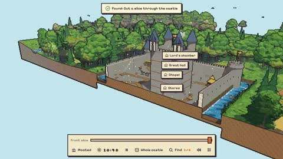

[← Back to gallery](../browse/education.en.md) · [简体中文](2114665745116508166.md)

# A 3D Castle Illustration You Can Slice Open

**[An Xuan · @anxuanng](https://x.com/anxuanng)** · Education & explainers · 28s

> Discovery pool · Source verified; catalog details being completed.

**[▶ Open gallery to play](https://guanmo-ai.github.io/awesome-ai-motion/?lang=en#case-2114665745116508166)** · [Original post](https://x.com/anxuanng/status/2114665745116508166)

Click the cover to open the gallery and play.

Walls, courtyards and towers open through cutaways to reveal a castle's internal spatial relationships.

No public prompt has been verified. [View the original post](https://x.com/anxuanng/status/2114665745116508166)

Bookmarks — · Likes — · Views —

## Source record

- Original post: [@anxuanng](https://x.com/anxuanng/status/2114665745116508166) · 2026-10-26T10:29:36+00:00
- Model attribution: Claude Opus 5.5 · [Creator’s statement](https://x.com/anxuanng/status/2114665745116508166)
- Prompt lookup: [Creator post](https://x.com/anxuanng/status/2114665745116508166) · 2026-11-02 09:52 UTC
- Cover source: [Original cover source](https://x.com/anxuanng/status/2114665745116508166) · 5.61s
- Metrics snapshot: [Original X post](https://x.com/anxuanng/status/2114665745116508166) · 2026-11-02 09:15 UTC
- Gallery video source: [Original post media record](https://x.com/anxuanng/status/2114665745116508166) · 2026-11-02 09:52 UTC · Post/media correspondence and media response checked; external reference, no re-upload

Model attribution is based on creator statements. Prompts have not been independently rerun; sound and visuals have not received a uniform quality rating. Videos reference original post media, not our uploads; redistribution permission has not been verified.
