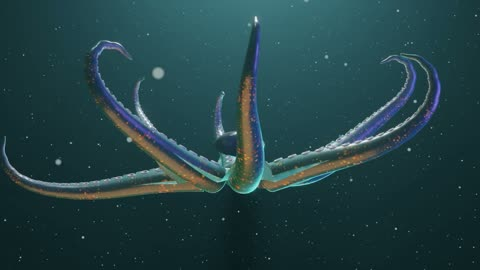

[← Back to gallery](../browse/interactive.en.md) · [简体中文](2114691597942268163.md)

# An Abstract Octopus-Shaped 3D Self-Portrait

**[Digi\_Rat · @digi\_dot\_exe](https://x.com/digi_dot_exe)** · 3D & interactive · 20s

> Discovery pool · Source verified; catalog details being completed.

**[▶ Open gallery to play](https://guanmo-ai.github.io/awesome-ai-motion/?lang=en#case-2114691597942268163)** · [Original post](https://x.com/digi_dot_exe/status/2114691597942268163)

Click the cover to open the gallery and play.

Arms, flowing color bands and a stone form an abstract sculpture moving in underwater light.

No public prompt has been verified. [View the original post](https://x.com/digi_dot_exe/status/2114691597942268163)

Bookmarks — · Likes — · Views —

## Source record

- Original post: [@digi\_dot\_exe](https://x.com/digi_dot_exe/status/2114691597942268163) · 2026-10-26T12:12:20+00:00
- Model attribution: Claude Opus 5.5 · [Creator’s statement](https://x.com/digi_dot_exe/status/2114691597942268163)
- Prompt lookup: [Creator post](https://x.com/digi_dot_exe/status/2114691597942268163) · 2026-11-02 09:52 UTC
- Cover source: [Original cover source](https://x.com/digi_dot_exe/status/2114691597942268163) · 4s
- Metrics snapshot: [Original X post](https://x.com/digi_dot_exe/status/2114691597942268163) · 2026-11-02 09:15 UTC
- Gallery video source: [Original post media record](https://x.com/digi_dot_exe/status/2114691597942268163) · 2026-11-02 09:52 UTC · Post/media correspondence and media response checked; external reference, no re-upload

Model attribution is based on creator statements. Prompts have not been independently rerun; sound and visuals have not received a uniform quality rating. Videos reference original post media, not our uploads; redistribution permission has not been verified.
