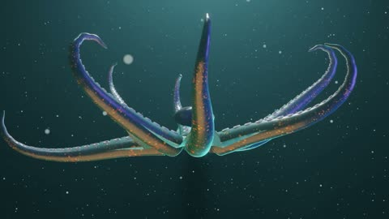

[← 返回图库](../browse/interactive.md) · [English](2114691597942268163.en.md)

# 章鱼形态的抽象三维自画像

**[Digi\_Rat · @digi\_dot\_exe](https://x.com/digi_dot_exe)** · 交互演示 · 20s

> 发现池 · 来源已核对，编目资料待完善。

**[▶ 打开画廊播放](https://guanmo-ai.github.io/awesome-ai-motion/#case-2114691597942268163)** · [作者原帖](https://x.com/digi_dot_exe/status/2114691597942268163)

点击封面打开画廊播放。

触腕、流动色带与石块构成抽象雕塑，在水下光线中展开运动。

未取得作者公开提示词。 [查看作者原帖](https://x.com/digi_dot_exe/status/2114691597942268163)

收藏 — · 点赞 — · 浏览 —

## 来源记录

- 作品原帖: [@digi\_dot\_exe](https://x.com/digi_dot_exe/status/2114691597942268163) · 2026-10-26T12:12:20+00:00
- 模型归因: Claude Opus 5.5 · [作者说明](https://x.com/digi_dot_exe/status/2114691597942268163)
- 提示词查阅记录: [作者原帖](https://x.com/digi_dot_exe/status/2114691597942268163) · 2026-11-02 09:52 UTC
- 封面来源: [原帖封面来源](https://x.com/digi_dot_exe/status/2114691597942268163) · 4s
- 互动快照: [X 原帖](https://x.com/digi_dot_exe/status/2114691597942268163) · 2026-11-02 09:15 UTC
- 画廊原视频: [原帖媒体记录](https://x.com/digi_dot_exe/status/2114691597942268163) · 2026-11-02 09:52 UTC · 已核对原帖媒体对应与媒体响应；外部引用，不重新上传

模型依据来自作者自述，未独立重跑提示词，也未对音画作统一质量评级。视频引用作者原帖媒体，未由本站重新上传，转载许可未确认。
