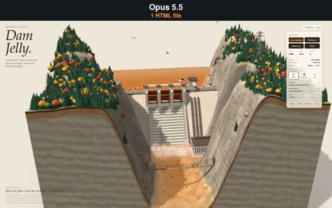

[← Back to gallery](../browse/interactive.en.md) · [简体中文](2114708382594543838.md)

# A Jelly Dam, Floods and Turbines

**[Bengi · @Bengiyai](https://x.com/Bengiyai)** · 3D & interactive · 18s

> Discovery pool · Source verified; catalog details being completed.

**[▶ Open gallery to play](https://guanmo-ai.github.io/awesome-ai-motion/?lang=en#case-2114708382594543838)** · [Original post](https://x.com/Bengiyai/status/2114708382594543838)

Click the cover to open the gallery and play.

Water levels, gates and overflow respond together in a miniature dam with deforming jelly material.

No public prompt has been verified. [View the original post](https://x.com/Bengiyai/status/2114708382594543838)

Bookmarks — · Likes — · Views —

## Source record

- Original post: [@Bengiyai](https://x.com/Bengiyai/status/2114708382594543838) · 2026-10-26T13:19:02+00:00
- Model attribution: Claude Opus 5.5 · [Creator’s statement](https://x.com/Bengiyai/status/2114708382594543838)
- Prompt lookup: [Creator post](https://x.com/Bengiyai/status/2114708382594543838) · 2026-11-02 15:38 UTC
- Cover source: [Original cover source](https://x.com/Bengiyai/status/2114708382594543838) · 3.61s
- Metrics snapshot: [Original X post](https://x.com/Bengiyai/status/2114708382594543838) · 2026-11-02 15:08 UTC
- Gallery video source: [Original post media record](https://x.com/Bengiyai/status/2114708382594543838) · 2026-11-02 15:38 UTC · Post/media correspondence and media response checked; external reference, no re-upload

Model attribution is based on creator statements. Prompts have not been independently rerun; sound and visuals have not received a uniform quality rating. Videos reference original post media, not our uploads; redistribution permission has not been verified.
