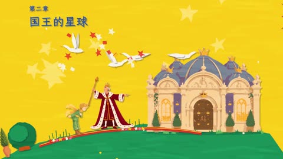

[← Back to gallery](../browse/stories.en.md) · [简体中文](2114942260353868116.md)

# The Little Prince in Paper-Cut Planet Scenes

**[Sac · @Saccc\_c](https://x.com/Saccc_c)** · Narrative films · 74s

> Discovery pool · Source verified; catalog details being completed.

**[▶ Open gallery to play](https://guanmo-ai.github.io/awesome-ai-motion/?lang=en#case-2114942260353868116)** · [Original post](https://x.com/Saccc_c/status/2114942260353868116)

Click the cover to open the gallery and play.

[huashu-art-motion art-animation skill](https://github.com/alchaincyf/huashu-art-motion)

The Little Prince visits planetary scenes including the king and geographer, using paper-cut layers, character motion and chapter captions.

## Source & web pages

- **Related tool**：[huashu-art-motion art-animation skill](https://github.com/alchaincyf/huashu-art-motion) · [MIT](https://github.com/alchaincyf/huashu-art-motion/blob/main/LICENSE)
  A general production tool with MIT code and docs. Fonts retain OFL terms and stroke data retains the Arphic Public License. Huashu character artwork and Clawd demo films are excluded from MIT. These terms do not establish the complete source or license of this Little Prince short.
  [Link source](https://x.com/Saccc_c/status/2114942260353868116) · Link checked 2026-11-03 09:18 UTC

No public prompt has been verified. [View the original post](https://x.com/Saccc_c/status/2114942260353868116)

Bookmarks — · Likes — · Views —

## Source record

- Original post: [@Saccc\_c](https://x.com/Saccc_c/status/2114942260353868116) · 2026-10-27T04:48:23+00:00
- Model attribution: Claude Opus 5.5 · [Creator’s statement](https://x.com/Saccc_c/status/2114942260353868116)
- Prompt lookup: [Creator post](https://x.com/Saccc_c/status/2114942260353868116) · 2026-11-02 08:50 UTC
- Cover source: [Original cover source](https://x.com/Saccc_c/status/2114942260353868116) · 14.83s
- Metrics snapshot: [Original X post](https://x.com/Saccc_c/status/2114942260353868116) · 2026-11-02 08:41 UTC
- Gallery video source: [Original post media record](https://x.com/Saccc_c/status/2114942260353868116) · 2026-11-02 08:50 UTC · Post/media correspondence and media response checked; external reference, no re-upload

Model attribution is based on creator statements. Prompts have not been independently rerun; sound and visuals have not received a uniform quality rating. Videos reference original post media, not our uploads; redistribution permission has not been verified.
