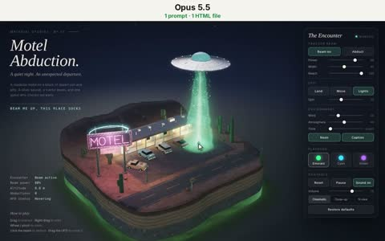

[← Back to gallery](../browse/interactive.en.md) · [简体中文](2115069592955482489.md)

# A UFO Beam over a Jelly Desert

**[Bengi · @Bengiyai](https://x.com/Bengiyai)** · 3D & interactive · 20s

> Discovery pool · Source verified; catalog details being completed.

**[▶ Open gallery to play](https://guanmo-ai.github.io/awesome-ai-motion/?lang=en#case-2115069592955482489)** · [Original post](https://x.com/Bengiyai/status/2115069592955482489)

Click the cover to open the gallery and play.

A hovering saucer lifts objects with a beam while the desert base and dust respond to physics.

No public prompt has been verified. [View the original post](https://x.com/Bengiyai/status/2115069592955482489)

Bookmarks — · Likes — · Views —

## Source record

- Original post: [@Bengiyai](https://x.com/Bengiyai/status/2115069592955482489) · 2026-10-27T13:14:21+00:00
- Model attribution: Claude Opus 5.5 · [Creator’s statement](https://x.com/Bengiyai/status/2115069592955482489)
- Prompt lookup: [Creator post](https://x.com/Bengiyai/status/2115069592955482489) · 2026-11-02 15:38 UTC
- Cover source: [Original cover source](https://x.com/Bengiyai/status/2115069592955482489) · 4.01s
- Metrics snapshot: [Original X post](https://x.com/Bengiyai/status/2115069592955482489) · 2026-11-02 15:08 UTC
- Gallery video source: [Original post media record](https://x.com/Bengiyai/status/2115069592955482489) · 2026-11-02 15:38 UTC · Post/media correspondence and media response checked; external reference, no re-upload

Model attribution is based on creator statements. Prompts have not been independently rerun; sound and visuals have not received a uniform quality rating. Videos reference original post media, not our uploads; redistribution permission has not been verified.
