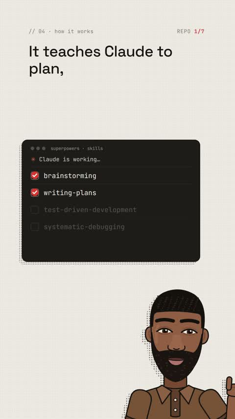

[← Back to gallery](../browse/education.en.md) · [简体中文](2115166136212111369.md)

# A Cartoon Presenter and Animated Tool Cards

**[Ayomide Adeji · @Aygramm\_](https://x.com/Aygramm_)** · Education & explainers · 55s

> Discovery pool · Source verified; catalog details being completed.

**[▶ Open gallery to play](https://guanmo-ai.github.io/awesome-ai-motion/?lang=en#case-2115166136212111369)** · [Original post](https://x.com/Aygramm_/status/2115166136212111369)

Click the cover to open the gallery and play.

A cartoon presenter, tool names, code cards and large typography introduce Claude tools and production steps.

No public prompt has been verified. [View the original post](https://x.com/Aygramm_/status/2115166136212111369)

Bookmarks — · Likes — · Views —

## Source record

- Original post: [@Aygramm\_](https://x.com/Aygramm_/status/2115166136212111369) · 2026-10-27T19:37:59+00:00
- Model attribution: Claude Opus 5.5 · [Creator’s statement](https://x.com/Aygramm_/status/2115166136212111369)
- Prompt lookup: [Creator post](https://x.com/Aygramm_/status/2115166136212111369) · 2026-11-02 08:50 UTC
- Cover source: [Original cover source](https://x.com/Aygramm_/status/2115166136212111369) · 10.97s
- Metrics snapshot: [Original X post](https://x.com/Aygramm_/status/2115166136212111369) · 2026-11-02 08:41 UTC
- Gallery video source: [Original post media record](https://x.com/Aygramm_/status/2115166136212111369) · 2026-11-02 08:50 UTC · Post/media correspondence and media response checked; external reference, no re-upload

Model attribution is based on creator statements. Prompts have not been independently rerun; sound and visuals have not received a uniform quality rating. Videos reference original post media, not our uploads; redistribution permission has not been verified.
