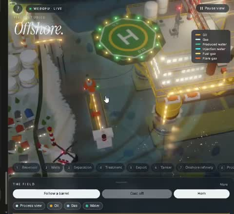

[← Back to gallery](../browse/education.en.md) · [简体中文](2115316442052940009.md)

# One Barrel from Seabed to Petrol Pump

**[KnightDuck · @OwlJStreet](https://x.com/OwlJStreet)** · Education & explainers · 46s

> Discovery pool · Source verified; catalog details being completed.

**[▶ Open gallery to play](https://guanmo-ai.github.io/awesome-ai-motion/?lang=en#case-2115316442052940009)** · [Original post](https://x.com/OwlJStreet/status/2115316442052940009)

Click the cover to open the gallery and play.

An offshore platform, tanker and refinery form a 3D process following one barrel through transport stages.

No public prompt has been verified. [View the original post](https://x.com/OwlJStreet/status/2115316442052940009)

Bookmarks — · Likes — · Views —

## Source record

- Original post: [@OwlJStreet](https://x.com/OwlJStreet/status/2115316442052940009) · 2026-10-28T05:35:15+00:00
- Model attribution: Claude Opus 5.5 · [Creator’s statement](https://x.com/OwlJStreet/status/2115316442052940009)
- Prompt lookup: [Creator post](https://x.com/OwlJStreet/status/2115316442052940009) · 2026-11-02 09:52 UTC
- Cover source: [Original cover source](https://x.com/OwlJStreet/status/2115316442052940009) · 9.15s
- Metrics snapshot: [Original X post](https://x.com/OwlJStreet/status/2115316442052940009) · 2026-11-02 09:15 UTC
- Gallery video source: [Original post media record](https://x.com/OwlJStreet/status/2115316442052940009) · 2026-11-02 09:52 UTC · Post/media correspondence and media response checked; external reference, no re-upload

Model attribution is based on creator statements. Prompts have not been independently rerun; sound and visuals have not received a uniform quality rating. Videos reference original post media, not our uploads; redistribution permission has not been verified.
