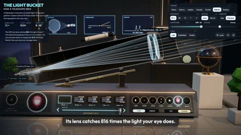

[← Back to gallery](../browse/education.en.md) · [简体中文](2115438976203153742.md)

# An Interactive Telescope Light-Path Explainer

**[Ryan Sael · @RyanSael](https://x.com/RyanSael)** · Education & explainers · 36s

> Discovery pool · Source verified; catalog details being completed.

**[▶ Open gallery to play](https://guanmo-ai.github.io/awesome-ai-motion/?lang=en#case-2115438976203153742)** · [Original post](https://x.com/RyanSael/status/2115438976203153742)

Click the cover to open the gallery and play.

[Interactive telescope light-path demo](https://sael.net/light-bucket)

Rays, lenses and lunar imagery move together to explain how a telescope collects and focuses light.

## Source & web pages

- **Public web page**：[Interactive telescope light-path demo](https://sael.net/light-bucket)
  [Link source](https://x.com/RyanSael/status/2115438976203153742) · Link checked 2026-11-02 09:52 UTC

No public prompt has been verified. [View the original post](https://x.com/RyanSael/status/2115438976203153742)

Bookmarks — · Likes — · Views —

## Source record

- Original post: [@RyanSael](https://x.com/RyanSael/status/2115438976203153742) · 2026-10-28T13:42:09+00:00
- Model attribution: Claude Opus 5.5 · [Creator’s statement](https://x.com/RyanSael/status/2115438976203153742)
- Prompt lookup: [Creator post](https://x.com/RyanSael/status/2115438976203153742) · 2026-11-02 09:52 UTC
- Cover source: [Original cover source](https://x.com/RyanSael/status/2115438976203153742) · 7.21s
- Metrics snapshot: [Original X post](https://x.com/RyanSael/status/2115438976203153742) · 2026-11-02 09:15 UTC
- Gallery video source: [Original post media record](https://x.com/RyanSael/status/2115438976203153742) · 2026-11-02 09:52 UTC · Post/media correspondence and media response checked; external reference, no re-upload

Model attribution is based on creator statements. Prompts have not been independently rerun; sound and visuals have not received a uniform quality rating. Videos reference original post media, not our uploads; redistribution permission has not been verified.
