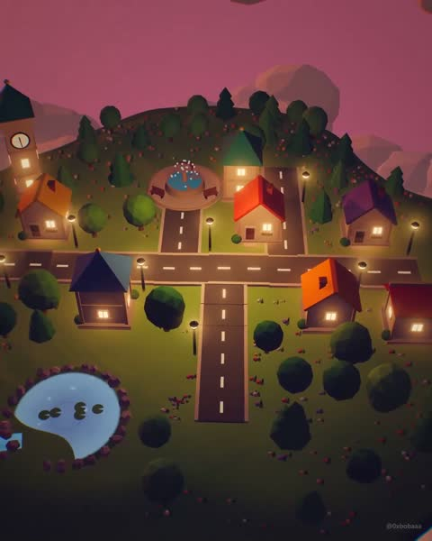

[← Back to gallery](../browse/interactive.en.md) · [简体中文](2115486834755035178.md)

# A Floating Island Grows into a Town at Dusk

**[0xbobaa · @0xbobaaa](https://x.com/0xbobaaa)** · 3D & interactive · 58s

> Discovery pool · Source verified; catalog details being completed.

**[▶ Open gallery to play](https://guanmo-ai.github.io/awesome-ai-motion/?lang=en#case-2115486834755035178)** · [Original post](https://x.com/0xbobaaa/status/2115486834755035178)

Click the cover to open the gallery and play.

An island, houses, roads and balloons form a town that shifts from daylight to glowing dusk; the creator says both imagery and music are coded.

The creator has shared instructions; this catalog links to the source without redistributing the full text or translation. [Read the creator’s original](https://x.com/0xbobaaa/status/2115486834755035178)

Bookmarks — · Likes — · Views —

## Source record

- Original post: [@0xbobaaa](https://x.com/0xbobaaa/status/2115486834755035178) · 2026-10-28T16:52:19+00:00
- Model attribution: Claude Opus 5.5 · [Creator’s statement](https://x.com/0xbobaaa/status/2115486834755035178)
- Prompt source: [Creator post](https://x.com/0xbobaaa/status/2115486834755035178) · 2026-11-02 08:50 UTC
- Cover source: [Original cover source](https://x.com/0xbobaaa/status/2115486834755035178) · 40.86s
- Metrics snapshot: [Original X post](https://x.com/0xbobaaa/status/2115486834755035178) · 2026-11-02 08:41 UTC
- Gallery video source: [Original post media record](https://x.com/0xbobaaa/status/2115486834755035178) · 2026-11-02 08:50 UTC · Post/media correspondence and media response checked; external reference, no re-upload

Model attribution is based on creator statements. Prompts have not been independently rerun; sound and visuals have not received a uniform quality rating. Videos reference original post media, not our uploads; redistribution permission has not been verified.
