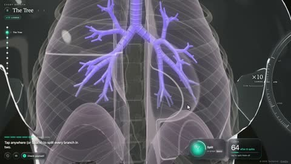

[← Back to gallery](../browse/education.en.md) · [简体中文](2115565230772392277.md)

# Oxygen's Interactive Journey from Air to Cells

**[Techartist · @techartist\_](https://x.com/techartist_)** · Education & explainers · 30s

> Discovery pool · Source verified; catalog details being completed.

**[▶ Open gallery to play](https://guanmo-ai.github.io/awesome-ai-motion/?lang=en#case-2115565230772392277)** · [Original post](https://x.com/techartist_/status/2115565230772392277)

Click the cover to open the gallery and play.

[Interactive oxygen-transport lesson](https://iamtechartist.com/breathing-and-respiration/)

3D animation connects breathing, gas exchange, circulation and cellular respiration, with exercises and questions, credited to the original creator.

## Source & web pages

- **Public web page**：[Interactive oxygen-transport lesson](https://iamtechartist.com/breathing-and-respiration/)
  [Link source](https://x.com/techartist_/status/2115565230772392277) · Link checked 2026-11-02 08:50 UTC

No public prompt has been verified. [View the original post](https://x.com/techartist_/status/2115565230772392277)

Bookmarks — · Likes — · Views —

## Source record

- Original post: [@techartist\_](https://x.com/techartist_/status/2115565230772392277) · 2026-10-28T22:03:50+00:00
- Model attribution: Claude Opus 5.5 · [Creator’s statement](https://x.com/techartist_/status/2115565230772392277)
- Prompt lookup: [Creator post](https://x.com/techartist_/status/2115565230772392277) · 2026-11-02 08:50 UTC
- Cover source: [Original cover source](https://x.com/techartist_/status/2115565230772392277) · 6.01s
- Metrics snapshot: [Original X post](https://x.com/techartist_/status/2115565230772392277) · 2026-11-02 08:41 UTC
- Gallery video source: [Original post media record](https://x.com/techartist_/status/2115565230772392277) · 2026-11-02 08:50 UTC · Post/media correspondence and media response checked; external reference, no re-upload

Model attribution is based on creator statements. Prompts have not been independently rerun; sound and visuals have not received a uniform quality rating. Videos reference original post media, not our uploads; redistribution permission has not been verified.
