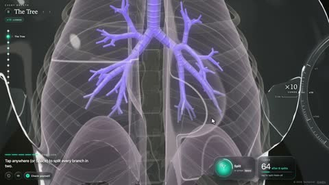

[← 返回图库](../browse/education.md) · [English](2115565230772392277.en.md)

# 氧分子从空气到细胞的交互旅程

**[Techartist · @techartist\_](https://x.com/techartist_)** · 知识讲解 · 30s

> 发现池 · 来源已核对，编目资料待完善。

**[▶ 打开画廊播放](https://guanmo-ai.github.io/awesome-ai-motion/#case-2115565230772392277)** · [作者原帖](https://x.com/techartist_/status/2115565230772392277)

点击封面打开画廊播放。

[氧气运输交互课程](https://iamtechartist.com/breathing-and-respiration/)

呼吸树、肺部交换、循环与细胞呼吸用三维动画串联，并配有练习与检测题；收录原作者作品。

## 源码与网页

- **公开网页**：[氧气运输交互课程](https://iamtechartist.com/breathing-and-respiration/)
  [链接出处](https://x.com/techartist_/status/2115565230772392277) · 链接核对 2026-11-02 08:50 UTC

未取得作者公开提示词。 [查看作者原帖](https://x.com/techartist_/status/2115565230772392277)

收藏 — · 点赞 — · 浏览 —

## 来源记录

- 作品原帖: [@techartist\_](https://x.com/techartist_/status/2115565230772392277) · 2026-10-28T22:03:50+00:00
- 模型归因: Claude Opus 5.5 · [作者说明](https://x.com/techartist_/status/2115565230772392277)
- 提示词查阅记录: [作者原帖](https://x.com/techartist_/status/2115565230772392277) · 2026-11-02 08:50 UTC
- 封面来源: [原帖封面来源](https://x.com/techartist_/status/2115565230772392277) · 6.01s
- 互动快照: [X 原帖](https://x.com/techartist_/status/2115565230772392277) · 2026-11-02 08:41 UTC
- 画廊原视频: [原帖媒体记录](https://x.com/techartist_/status/2115565230772392277) · 2026-11-02 08:50 UTC · 已核对原帖媒体对应与媒体响应；外部引用，不重新上传

模型依据来自作者自述，未独立重跑提示词，也未对音画作统一质量评级。视频引用作者原帖媒体，未由本站重新上传，转载许可未确认。
