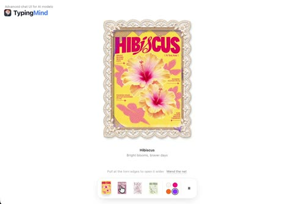

[← Back to gallery](../browse/interactive.en.md) · [简体中文](2115780819142979978.md)

# Tear a Mesh to Reveal Floral Art

**[Ann Nguyen · @ann\_nnng](https://x.com/ann_nnng)** · 3D & interactive · 42s

> Discovery pool · Source verified; catalog details being completed.

**[▶ Open gallery to play](https://guanmo-ai.github.io/awesome-ai-motion/?lang=en#case-2115780819142979978)** · [Original post](https://x.com/ann_nnng/status/2115780819142979978)

Click the cover to open the gallery and play.

A mesh tears under dragging to reveal floral artwork beneath it.

No public prompt has been verified. [View the original post](https://x.com/ann_nnng/status/2115780819142979978)

Bookmarks — · Likes — · Views —

## Source record

- Original post: [@ann\_nnng](https://x.com/ann_nnng/status/2115780819142979978) · 2026-10-29T12:20:31+00:00
- Model attribution: Claude Opus 5.5 · [Creator’s statement](https://x.com/ann_nnng/status/2115780819142979978)
- Prompt lookup: [Creator post](https://x.com/ann_nnng/status/2115780819142979978) · 2026-11-02 15:38 UTC
- Cover source: [Original cover source](https://x.com/ann_nnng/status/2115780819142979978) · 8.49s
- Metrics snapshot: [Original X post](https://x.com/ann_nnng/status/2115780819142979978) · 2026-11-02 15:08 UTC
- Gallery video source: [Original post media record](https://x.com/ann_nnng/status/2115780819142979978) · 2026-11-02 15:38 UTC · Post/media correspondence and media response checked; external reference, no re-upload

Model attribution is based on creator statements. Prompts have not been independently rerun; sound and visuals have not received a uniform quality rating. Videos reference original post media, not our uploads; redistribution permission has not been verified.
