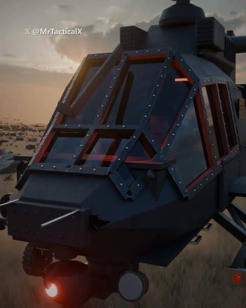

[← Back to gallery](../browse/interactive.en.md) · [简体中文](2115799693493969236.md)

# A Black Helicopter Blender Trailer

**[Mr Tactical · @MrTacticalX](https://x.com/MrTacticalX)** · 3D & interactive · 32s

> Discovery pool · Source verified; catalog details being completed.

**[▶ Open gallery to play](https://guanmo-ai.github.io/awesome-ai-motion/?lang=en#case-2115799693493969236)** · [Original post](https://x.com/MrTacticalX/status/2115799693493969236)

Click the cover to open the gallery and play.

Cockpit, rotor and aircraft shots form a cinematic 3D trailer.

No public prompt has been verified. [View the original post](https://x.com/MrTacticalX/status/2115799693493969236)

Bookmarks — · Likes — · Views —

## Source record

- Original post: [@MrTacticalX](https://x.com/MrTacticalX/status/2115799693493969236) · 2026-10-29T13:35:31+00:00
- Model attribution: Claude Opus 5.5 · [Creator’s statement](https://x.com/MrTacticalX/status/2115799693493969236)
- Prompt lookup: [Creator post](https://x.com/MrTacticalX/status/2115799693493969236) · 2026-11-02 15:38 UTC
- Cover source: [Original cover source](https://x.com/MrTacticalX/status/2115799693493969236) · 6.37s
- Metrics snapshot: [Original X post](https://x.com/MrTacticalX/status/2115799693493969236) · 2026-11-02 15:05 UTC
- Gallery video source: [Original post media record](https://x.com/MrTacticalX/status/2115799693493969236) · 2026-11-02 15:38 UTC · Post/media correspondence and media response checked; external reference, no re-upload

Model attribution is based on creator statements. Prompts have not been independently rerun; sound and visuals have not received a uniform quality rating. Videos reference original post media, not our uploads; redistribution permission has not been verified.
