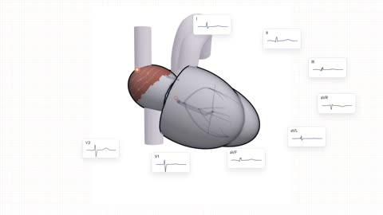

[← Back to gallery](../browse/education.en.md) · [简体中文](2115898852704456739.md)

# Twelve ECG Leads Driven by a 3D Heart

**[Robert Y. Chen · @therealRYC](https://x.com/therealRYC)** · Education & explainers · 49s

> Discovery pool · Source verified; catalog details being completed.

**[▶ Open gallery to play](https://guanmo-ai.github.io/awesome-ai-motion/?lang=en#case-2115898852704456739)** · [Original post](https://x.com/therealRYC/status/2115898852704456739)

Click the cover to open the gallery and play.

[Creator’s published single-page build](https://github.com/therealryc/heart-in-twelve-leads) · [Twelve-lead interactive demo](https://therealryc.github.io/heart-in-twelve-leads/)

A 3D heart's electrical activity drives twelve ECG traces and comparisons of conduction changes; the creator identifies it as an early, not yet fact-checked teaching prototype.

## Source & web pages

- **Direct source**：[Creator’s published single-page build](https://github.com/therealryc/heart-in-twelve-leads) · No license specified
  The repository contains the built page only, with no separate project license identified; bundled libraries and fonts have their own terms. The creator says the teaching content has not been fully fact-checked.
  [Link source](https://therealryc.github.io/heart-in-twelve-leads/) · Link checked 2026-11-02 08:50 UTC
- **Public web page**：[Twelve-lead interactive demo](https://therealryc.github.io/heart-in-twelve-leads/)
  [Link source](https://x.com/therealRYC/status/2115898852704456739) · Link checked 2026-11-02 08:50 UTC

No public prompt has been verified. [View the original post](https://x.com/therealRYC/status/2115898852704456739)

Bookmarks — · Likes — · Views —

## Source record

- Original post: [@therealRYC](https://x.com/therealRYC/status/2115898852704456739) · 2026-10-29T20:09:32+00:00
- Model attribution: Claude Opus 5.5 · [Creator’s statement](https://x.com/therealRYC/status/2115898852704456739)
- Prompt lookup: [Creator post](https://x.com/therealRYC/status/2115898852704456739) · 2026-11-02 08:50 UTC
- Cover source: [Original cover source](https://x.com/therealRYC/status/2115898852704456739) · 9.76s
- Metrics snapshot: [Original X post](https://x.com/therealRYC/status/2115898852704456739) · 2026-11-02 08:41 UTC
- Gallery video source: [Original post media record](https://x.com/therealRYC/status/2115898852704456739) · 2026-11-02 08:50 UTC · Post/media correspondence and media response checked; external reference, no re-upload

Model attribution is based on creator statements. Prompts have not been independently rerun; sound and visuals have not received a uniform quality rating. Videos reference original post media, not our uploads; redistribution permission has not been verified.
