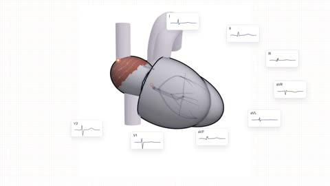

[← 返回图库](../browse/education.md) · [English](2115898852704456739.en.md)

# 十二导联心电图与三维心脏联动

**[Robert Y. Chen · @therealRYC](https://x.com/therealRYC)** · 知识讲解 · 49s

> 发现池 · 来源已核对，编目资料待完善。

**[▶ 打开画廊播放](https://guanmo-ai.github.io/awesome-ai-motion/#case-2115898852704456739)** · [作者原帖](https://x.com/therealRYC/status/2115898852704456739)

点击封面打开画廊播放。

[作者公开的单页构建代码](https://github.com/therealryc/heart-in-twelve-leads) · [十二导联交互演示](https://therealryc.github.io/heart-in-twelve-leads/)

三维心脏的电活动与十二导联波形同时变化，并展示传导异常的对照；作者明确这是尚未逐项核实的早期教学原型。

## 源码与网页

- **直接源码**：[作者公开的单页构建代码](https://github.com/therealryc/heart-in-twelve-leads) · 未标明许可
  仓库仅含构建后的页面；未见单独项目许可，内含依赖与字体另有条款。作者声明教学内容尚未逐项核实。
  [链接出处](https://therealryc.github.io/heart-in-twelve-leads/) · 链接核对 2026-11-02 08:50 UTC
- **公开网页**：[十二导联交互演示](https://therealryc.github.io/heart-in-twelve-leads/)
  [链接出处](https://x.com/therealRYC/status/2115898852704456739) · 链接核对 2026-11-02 08:50 UTC

未取得作者公开提示词。 [查看作者原帖](https://x.com/therealRYC/status/2115898852704456739)

收藏 — · 点赞 — · 浏览 —

## 来源记录

- 作品原帖: [@therealRYC](https://x.com/therealRYC/status/2115898852704456739) · 2026-10-29T20:09:32+00:00
- 模型归因: Claude Opus 5.5 · [作者说明](https://x.com/therealRYC/status/2115898852704456739)
- 提示词查阅记录: [作者原帖](https://x.com/therealRYC/status/2115898852704456739) · 2026-11-02 08:50 UTC
- 封面来源: [原帖封面来源](https://x.com/therealRYC/status/2115898852704456739) · 9.76s
- 互动快照: [X 原帖](https://x.com/therealRYC/status/2115898852704456739) · 2026-11-02 08:41 UTC
- 画廊原视频: [原帖媒体记录](https://x.com/therealRYC/status/2115898852704456739) · 2026-11-02 08:50 UTC · 已核对原帖媒体对应与媒体响应；外部引用，不重新上传

模型依据来自作者自述，未独立重跑提示词，也未对音画作统一质量评级。视频引用作者原帖媒体，未由本站重新上传，转载许可未确认。
