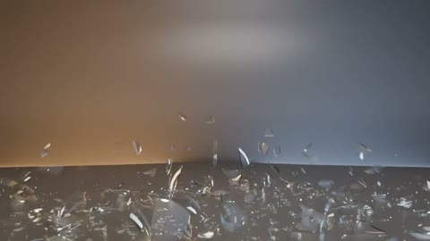

[← Back to gallery](../browse/interactive.en.md) · [简体中文](2115947219971105063.md)

# Glass Shatters and Restores

**[Charlotte · @Charlotteqozf](https://x.com/Charlotteqozf)** · 3D & interactive · 14s

> Discovery pool · Source verified; catalog details being completed.

**[▶ Open gallery to play](https://guanmo-ai.github.io/awesome-ai-motion/?lang=en#case-2115947219971105063)** · [Original post](https://x.com/Charlotteqozf/status/2115947219971105063)

Click the cover to open the gallery and play.

Glass falls apart and reforms, with impact sounds synthesized from collision data.

No public prompt has been verified. [View the original post](https://x.com/Charlotteqozf/status/2115947219971105063)

Bookmarks — · Likes — · Views —

## Source record

- Original post: [@Charlotteqozf](https://x.com/Charlotteqozf/status/2115947219971105063) · 2026-10-29T23:21:44+00:00
- Model attribution: Claude Opus 5.5 · [Creator’s statement](https://x.com/Charlotteqozf/status/2115947219971105063)
- Prompt lookup: [Creator post](https://x.com/Charlotteqozf/status/2115947219971105063) · 2026-11-02 09:52 UTC
- Cover source: [Original cover source](https://x.com/Charlotteqozf/status/2115947219971105063) · 2.8s
- Metrics snapshot: [Original X post](https://x.com/Charlotteqozf/status/2115947219971105063) · 2026-11-02 09:15 UTC
- Gallery video source: [Original post media record](https://x.com/Charlotteqozf/status/2115947219971105063) · 2026-11-02 09:52 UTC · Post/media correspondence and media response checked; external reference, no re-upload

Model attribution is based on creator statements. Prompts have not been independently rerun; sound and visuals have not received a uniform quality rating. Videos reference original post media, not our uploads; redistribution permission has not been verified.
