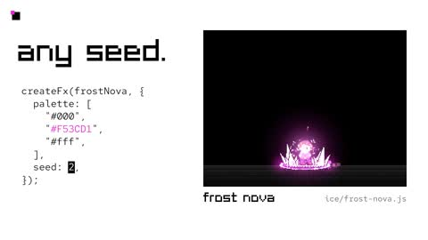

[← Back to gallery](../browse/motion.en.md) · [简体中文](2116062680121540611.md)

# Pixel Effects: Casts, Impacts and Palette Changes

**[Rehan Sheikh · @rehan\_shei](https://x.com/rehan_shei)** · Motion design · 40s

> Discovery pool · Source verified; catalog details being completed.

**[▶ Open gallery to play](https://guanmo-ai.github.io/awesome-ai-motion/?lang=en#case-2116062680121540611)** · [Original post](https://x.com/rehan_shei/status/2116062680121540611)

Click the cover to open the gallery and play.

[Pixel-effects code and creation skill](https://github.com/patch-gg/pixelfx) · [Interactive pixel-effects gallery](https://patch-gg.github.io/pixelfx/)

Character actions, frost and magic follow anticipation, impact and recovery, followed by palette and seed variations of the same coded effect.

## Source & web pages

- **Direct source**：[Pixel-effects code and creation skill](https://github.com/patch-gg/pixelfx) · [MIT](https://github.com/patch-gg/pixelfx/blob/main/LICENSE)
  Code and effects use MIT; the Patch Pixel font is excluded. The post mentions 232 effects while the saved repository lists 244, so the recording may use an earlier version.
  [Link source](https://x.com/rehan_shei/status/2116062680121540611) · Link checked 2026-11-03 09:18 UTC
- **Public web page**：[Interactive pixel-effects gallery](https://patch-gg.github.io/pixelfx/)
  [Link source](https://github.com/patch-gg/pixelfx) · Link checked 2026-11-02 08:50 UTC

No public prompt has been verified. [View the original post](https://x.com/rehan_shei/status/2116062680121540611)

Bookmarks — · Likes — · Views —

## Source record

- Original post: [@rehan\_shei](https://x.com/rehan_shei/status/2116062680121540611) · 2026-10-30T07:00:32+00:00
- Model attribution: Claude Opus 5.5 · [Creator’s statement](https://x.com/rehan_shei/status/2116062680121540611)
- Prompt lookup: [Creator post](https://x.com/rehan_shei/status/2116062680121540611) · 2026-11-02 08:50 UTC
- Cover source: [Original cover source](https://x.com/rehan_shei/status/2116062680121540611) · 28.13s
- Metrics snapshot: [Original X post](https://x.com/rehan_shei/status/2116062680121540611) · 2026-11-02 08:41 UTC
- Gallery video source: [Original post media record](https://x.com/rehan_shei/status/2116062680121540611) · 2026-11-02 08:50 UTC · Post/media correspondence and media response checked; external reference, no re-upload

Model attribution is based on creator statements. Prompts have not been independently rerun; sound and visuals have not received a uniform quality rating. Videos reference original post media, not our uploads; redistribution permission has not been verified.
