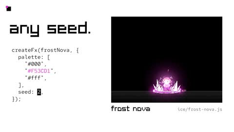

[← 返回图库](../browse/motion.md) · [English](2116062680121540611.en.md)

# 像素特效库的施法、冲击与变色

**[Rehan Sheikh · @rehan\_shei](https://x.com/rehan_shei)** · 短动效 · 40s

> 发现池 · 来源已核对，编目资料待完善。

**[▶ 打开画廊播放](https://guanmo-ai.github.io/awesome-ai-motion/#case-2116062680121540611)** · [作者原帖](https://x.com/rehan_shei/status/2116062680121540611)

点击封面打开画廊播放。

[像素特效代码与制作 Skill](https://github.com/patch-gg/pixelfx) · [像素特效交互画廊](https://patch-gg.github.io/pixelfx/)

角色动作、冰霜与魔法效果按蓄力、命中和恢复串联，随后展示同一代码特效的配色与随机种子变化。

## 源码与网页

- **直接源码**：[像素特效代码与制作 Skill](https://github.com/patch-gg/pixelfx) · [MIT](https://github.com/patch-gg/pixelfx/blob/main/LICENSE)
  代码与特效采用 MIT；Patch Pixel 字体不在该许可内。原帖称232项，保存的仓库列出244项，录制版本可能不同。
  [链接出处](https://x.com/rehan_shei/status/2116062680121540611) · 链接核对 2026-11-03 09:18 UTC
- **公开网页**：[像素特效交互画廊](https://patch-gg.github.io/pixelfx/)
  [链接出处](https://github.com/patch-gg/pixelfx) · 链接核对 2026-11-02 08:50 UTC

未取得作者公开提示词。 [查看作者原帖](https://x.com/rehan_shei/status/2116062680121540611)

收藏 — · 点赞 — · 浏览 —

## 来源记录

- 作品原帖: [@rehan\_shei](https://x.com/rehan_shei/status/2116062680121540611) · 2026-10-30T07:00:32+00:00
- 模型归因: Claude Opus 5.5 · [作者说明](https://x.com/rehan_shei/status/2116062680121540611)
- 提示词查阅记录: [作者原帖](https://x.com/rehan_shei/status/2116062680121540611) · 2026-11-02 08:50 UTC
- 封面来源: [原帖封面来源](https://x.com/rehan_shei/status/2116062680121540611) · 28.13s
- 互动快照: [X 原帖](https://x.com/rehan_shei/status/2116062680121540611) · 2026-11-02 08:41 UTC
- 画廊原视频: [原帖媒体记录](https://x.com/rehan_shei/status/2116062680121540611) · 2026-11-02 08:50 UTC · 已核对原帖媒体对应与媒体响应；外部引用，不重新上传

模型依据来自作者自述，未独立重跑提示词，也未对音画作统一质量评级。视频引用作者原帖媒体，未由本站重新上传，转载许可未确认。
