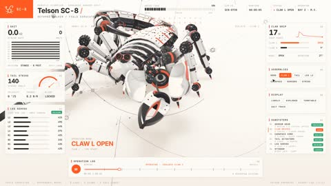

[← 返回图库](../browse/interactive.md) · [English](2116277601794724232.en.md)

# 机械蝎子的步态与全身拆解

**[Nyxera · @Nyxera0x](https://x.com/Nyxera0x)** · 交互演示 · 26s

> 发现池 · 来源已核对，编目资料待完善。

**[▶ 打开画廊播放](https://guanmo-ai.github.io/awesome-ai-motion/#case-2116277601794724232)** · [作者原帖](https://x.com/Nyxera0x/status/2116277601794724232)

点击封面打开画廊播放。

[机械拆解通用制作 Skill](https://github.com/elvarofficial/teardown)

八足步态、钳爪和尾刺分步演示，随后装甲与内部机构展开；侧边读数跟随动作变化。

## 源码与网页

- **相关工具**：[机械拆解通用制作 Skill](https://github.com/elvarofficial/teardown) · [MIT](https://github.com/elvarofficial/teardown/blob/main/LICENSE)
  原帖引用的制作方法所链接的通用工具；不等同于这支影片的完整工程。
  [链接出处](https://x.com/elvar_official/status/2116174609355571402) · 链接核对 2026-11-02 08:50 UTC

未取得作者公开提示词。 [查看作者原帖](https://x.com/Nyxera0x/status/2116277601794724232)

收藏 — · 点赞 — · 浏览 —

## 来源记录

- 作品原帖: [@Nyxera0x](https://x.com/Nyxera0x/status/2116277601794724232) · 2026-10-30T21:14:33+00:00
- 模型归因: Claude Opus 5.5 · [作者说明](https://x.com/Nyxera0x/status/2116277601794724232)
- 提示词查阅记录: [作者原帖](https://x.com/Nyxera0x/status/2116277601794724232) · 2026-11-02 08:50 UTC
- 封面来源: [原帖封面来源](https://x.com/Nyxera0x/status/2116277601794724232) · 5.2s
- 互动快照: [X 原帖](https://x.com/Nyxera0x/status/2116277601794724232) · 2026-11-02 08:41 UTC
- 画廊原视频: [原帖媒体记录](https://x.com/Nyxera0x/status/2116277601794724232) · 2026-11-02 08:50 UTC · 已核对原帖媒体对应与媒体响应；外部引用，不重新上传

模型依据来自作者自述，未独立重跑提示词，也未对音画作统一质量评级。视频引用作者原帖媒体，未由本站重新上传，转载许可未确认。
