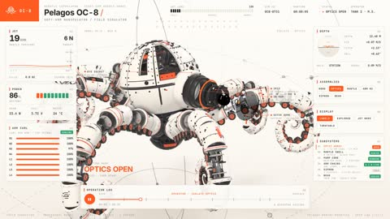

[← Back to gallery](../browse/interactive.en.md) · [简体中文](2116289885870981296.md)

# Robotic Octopus: Optics, Arms and Teardown

**[Fokki · @0x\_fokki](https://x.com/0x_fokki)** · 3D & interactive · 25s

> Discovery pool · Source verified; catalog details being completed.

**[▶ Open gallery to play](https://guanmo-ai.github.io/awesome-ai-motion/?lang=en#case-2116289885870981296)** · [Original post](https://x.com/0x_fokki/status/2116289885870981296)

Click the cover to open the gallery and play.

[General mechanical-teardown production skill](https://github.com/elvarofficial/teardown)

The optics, shell and articulated arms open in sequence before a turntable teardown and reassembly of the robotic octopus.

## Source & web pages

- **Related tool**：[General mechanical-teardown production skill](https://github.com/elvarofficial/teardown) · [MIT](https://github.com/elvarofficial/teardown/blob/main/LICENSE)
  A general tool linked by the production guide quoted in the post; it is not the complete project for this film.
  [Link source](https://x.com/elvar_official/status/2116174609355571402) · Link checked 2026-11-02 08:50 UTC

No public prompt has been verified. [View the original post](https://x.com/0x_fokki/status/2116289885870981296)

Bookmarks — · Likes — · Views —

## Source record

- Original post: [@0x\_fokki](https://x.com/0x_fokki/status/2116289885870981296) · 2026-10-30T22:03:22+00:00
- Model attribution: Claude Opus 5.5 · [Creator’s statement](https://x.com/0x_fokki/status/2116289885870981296)
- Prompt lookup: [Creator post](https://x.com/0x_fokki/status/2116289885870981296) · 2026-11-02 08:50 UTC
- Cover source: [Original cover source](https://x.com/0x_fokki/status/2116289885870981296) · 5s
- Metrics snapshot: [Original X post](https://x.com/0x_fokki/status/2116289885870981296) · 2026-11-02 08:41 UTC
- Gallery video source: [Original post media record](https://x.com/0x_fokki/status/2116289885870981296) · 2026-11-02 08:50 UTC · Post/media correspondence and media response checked; external reference, no re-upload

Model attribution is based on creator statements. Prompts have not been independently rerun; sound and visuals have not received a uniform quality rating. Videos reference original post media, not our uploads; redistribution permission has not been verified.
