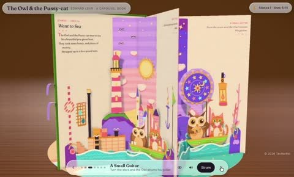

[← Back to gallery](../browse/interactive.en.md) · [简体中文](2116407421065482362.md)

# The Owl and the Pussy-cat as a carousel book

**[Techartist · @techartist\_](https://x.com/techartist_)** · 3D & interactive · 24s

> Discovery pool · Source verified; catalog details being completed.

**[▶ Open gallery to play](https://guanmo-ai.github.io/awesome-ai-motion/?lang=en#case-2116407421065482362)** · [Original post](https://x.com/techartist_/status/2116407421065482362)

Click the cover to open the gallery and play.

Pages open into a colourful carousel theatre, revealing an owl, a cat and scenes from the poem through turns and pop-up structures.

No public prompt has been verified. [View the original post](https://x.com/techartist_/status/2116407421065482362)

Bookmarks — · Likes — · Views —

## Source record

- Original post: [@techartist\_](https://x.com/techartist_/status/2116407421065482362) · 2026-10-31T05:50:24.000Z
- Model attribution: Claude Opus 5.5 · [Creator’s statement](https://x.com/techartist_/status/2116407421065482362)
- Prompt lookup: [Creator post](https://x.com/techartist_/status/2116407421065482362) · 2026-11-09 10:53 UTC
- Cover source: [Original cover source](https://x.com/techartist_/status/2116407421065482362) · 4.76s
- Metrics snapshot: [Original X post](https://x.com/techartist_/status/2116407421065482362) · 2026-11-09 10:46 UTC
- Gallery video source: [Original post media record](https://x.com/techartist_/status/2116407421065482362) · 2026-11-09 10:53 UTC · Post/media correspondence and media response checked; external reference, no re-upload

Model attribution is based on creator statements. Prompts have not been independently rerun; sound and visuals have not received a uniform quality rating. Videos reference original post media, not our uploads; redistribution permission has not been verified.
