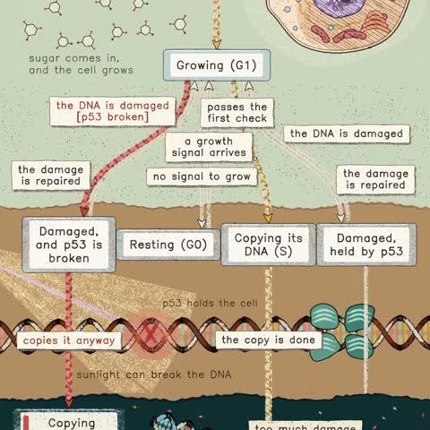

[← Back to gallery](../browse/education.en.md) · [简体中文](2116423724379656329.md)

# A Statechart of One Animal Cell's Life

**[Kevin Ngo · @kevin\_t\_ngo](https://x.com/kevin_t_ngo)** · Education & explainers · 45s

> Discovery pool · Source verified; catalog details being completed.

**[▶ Open gallery to play](https://guanmo-ai.github.io/awesome-ai-motion/?lang=en#case-2116423724379656329)** · [Original post](https://x.com/kevin_t_ngo/status/2116423724379656329)

Click the cover to open the gallery and play.

[Animal-cell animation directory](https://github.com/kevintngo/statechart-art/tree/main/one-becomes-two) · [Animal-cell life-cycle demo](https://kevintngo.github.io/statechart-art/one-becomes-two/)

Cell-division drawings, arrows and state labels connect the life cycle as an animated process.

## Source & web pages

- **Direct source**：[Animal-cell animation directory](https://github.com/kevintngo/statechart-art/tree/main/one-becomes-two) · [MIT](https://github.com/kevintngo/statechart-art/blob/main/LICENSE)
  [Link source](https://kevintngo.github.io/statechart-art/one-becomes-two/) · Link checked 2026-11-02 09:52 UTC
- **Public web page**：[Animal-cell life-cycle demo](https://kevintngo.github.io/statechart-art/one-becomes-two/)
  [Link source](https://x.com/kevin_t_ngo/status/2116423724379656329) · Link checked 2026-11-02 09:52 UTC

No public prompt has been verified. [View the original post](https://x.com/kevin_t_ngo/status/2116423724379656329)

Bookmarks — · Likes — · Views —

## Source record

- Original post: [@kevin\_t\_ngo](https://x.com/kevin_t_ngo/status/2116423724379656329) · 2026-10-31T06:55:11+00:00
- Model attribution: Claude Opus 5.5 · [Creator’s statement](https://x.com/kevin_t_ngo/status/2116423724379656329)
- Prompt lookup: [Creator post](https://x.com/kevin_t_ngo/status/2116423724379656329) · 2026-11-02 09:52 UTC
- Cover source: [Original cover source](https://x.com/kevin_t_ngo/status/2116423724379656329) · 8.91s
- Metrics snapshot: [Original X post](https://x.com/kevin_t_ngo/status/2116423724379656329) · 2026-11-02 09:15 UTC
- Gallery video source: [Original post media record](https://x.com/kevin_t_ngo/status/2116423724379656329) · 2026-11-02 09:52 UTC · Post/media correspondence and media response checked; external reference, no re-upload

Model attribution is based on creator statements. Prompts have not been independently rerun; sound and visuals have not received a uniform quality rating. Videos reference original post media, not our uploads; redistribution permission has not been verified.
