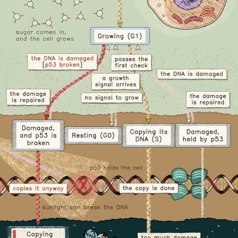

[← 返回图库](../browse/education.md) · [English](2116423724379656329.en.md)

# 一个动物细胞的状态变化图

**[Kevin Ngo · @kevin\_t\_ngo](https://x.com/kevin_t_ngo)** · 知识讲解 · 45s

> 发现池 · 来源已核对，编目资料待完善。

**[▶ 打开画廊播放](https://guanmo-ai.github.io/awesome-ai-motion/#case-2116423724379656329)** · [作者原帖](https://x.com/kevin_t_ngo/status/2116423724379656329)

点击封面打开画廊播放。

[动物细胞动画目录](https://github.com/kevintngo/statechart-art/tree/main/one-becomes-two) · [动物细胞生命周期演示](https://kevintngo.github.io/statechart-art/one-becomes-two/)

细胞分裂图、箭头与状态标签联动，将生命周期画成动态流程。

## 源码与网页

- **直接源码**：[动物细胞动画目录](https://github.com/kevintngo/statechart-art/tree/main/one-becomes-two) · [MIT](https://github.com/kevintngo/statechart-art/blob/main/LICENSE)
  [链接出处](https://kevintngo.github.io/statechart-art/one-becomes-two/) · 链接核对 2026-11-02 09:52 UTC
- **公开网页**：[动物细胞生命周期演示](https://kevintngo.github.io/statechart-art/one-becomes-two/)
  [链接出处](https://x.com/kevin_t_ngo/status/2116423724379656329) · 链接核对 2026-11-02 09:52 UTC

未取得作者公开提示词。 [查看作者原帖](https://x.com/kevin_t_ngo/status/2116423724379656329)

收藏 — · 点赞 — · 浏览 —

## 来源记录

- 作品原帖: [@kevin\_t\_ngo](https://x.com/kevin_t_ngo/status/2116423724379656329) · 2026-10-31T06:55:11+00:00
- 模型归因: Claude Opus 5.5 · [作者说明](https://x.com/kevin_t_ngo/status/2116423724379656329)
- 提示词查阅记录: [作者原帖](https://x.com/kevin_t_ngo/status/2116423724379656329) · 2026-11-02 09:52 UTC
- 封面来源: [原帖封面来源](https://x.com/kevin_t_ngo/status/2116423724379656329) · 8.91s
- 互动快照: [X 原帖](https://x.com/kevin_t_ngo/status/2116423724379656329) · 2026-11-02 09:15 UTC
- 画廊原视频: [原帖媒体记录](https://x.com/kevin_t_ngo/status/2116423724379656329) · 2026-11-02 09:52 UTC · 已核对原帖媒体对应与媒体响应；外部引用，不重新上传

模型依据来自作者自述，未独立重跑提示词，也未对音画作统一质量评级。视频引用作者原帖媒体，未由本站重新上传，转载许可未确认。
