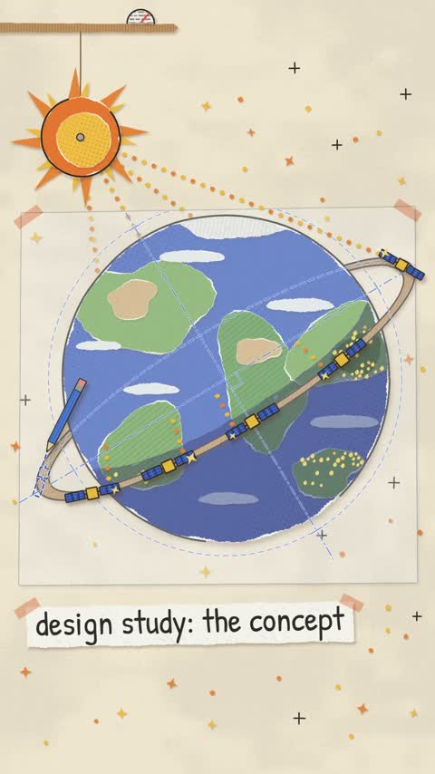

[← Back to gallery](../browse/education.en.md) · [简体中文](2116481641820418283.md)

# An Animated Explainer of AI Compute in Orbit

**[DreW · @devteamdrew](https://x.com/devteamdrew)** · Education & explainers · 50s

> Discovery pool · Source verified; catalog details being completed.

**[▶ Open gallery to play](https://guanmo-ai.github.io/awesome-ai-motion/?lang=en#case-2116481641820418283)** · [Original post](https://x.com/devteamdrew/status/2116481641820418283)

Click the cover to open the gallery and play.

Graphics, orbits and satellite scenes explain Project Suncatcher; this entry documents the visual treatment without independently verifying the mission claims.

No public prompt has been verified. [View the original post](https://x.com/devteamdrew/status/2116481641820418283)

Bookmarks — · Likes — · Views —

## Source record

- Original post: [@devteamdrew](https://x.com/devteamdrew/status/2116481641820418283) · 2026-10-31T10:45:20+00:00
- Model attribution: Claude Opus 5.5 · [Creator’s statement](https://x.com/devteamdrew/status/2116481641820418283)
- Prompt lookup: [Creator post](https://x.com/devteamdrew/status/2116481641820418283) · 2026-11-02 08:50 UTC
- Cover source: [Original cover source](https://x.com/devteamdrew/status/2116481641820418283) · 10.04s
- Metrics snapshot: [Original X post](https://x.com/devteamdrew/status/2116481641820418283) · 2026-11-02 08:42 UTC
- Gallery video source: [Original post media record](https://x.com/devteamdrew/status/2116481641820418283) · 2026-11-02 08:50 UTC · Post/media correspondence and media response checked; external reference, no re-upload

Model attribution is based on creator statements. Prompts have not been independently rerun; sound and visuals have not received a uniform quality rating. Videos reference original post media, not our uploads; redistribution permission has not been verified.
