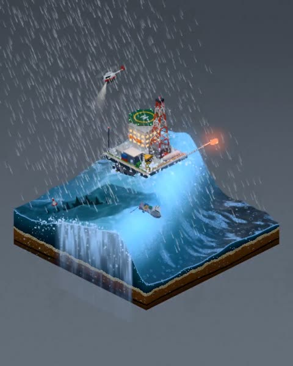

[← Back to gallery](../browse/interactive.en.md) · [简体中文](2116503955119255977.md)

# A Tiny Oil Rig, a Storm and a Giant Creature

**[Jeroen van Welsenes · @Guronnimo](https://x.com/Guronnimo)** · 3D & interactive · 24s

> Discovery pool · Source verified; catalog details being completed.

**[▶ Open gallery to play](https://guanmo-ai.github.io/awesome-ai-motion/?lang=en#case-2116503955119255977)** · [Original post](https://x.com/Guronnimo/status/2116503955119255977)

Click the cover to open the gallery and play.

Rain, large waves and an oil rig form a Three.js diorama before a giant creature changes its scale.

No public prompt has been verified. [View the original post](https://x.com/Guronnimo/status/2116503955119255977)

Bookmarks — · Likes — · Views —

## Source record

- Original post: [@Guronnimo](https://x.com/Guronnimo/status/2116503955119255977) · 2026-10-31T12:14:00+00:00
- Model attribution: Claude Opus 5.5 · [Creator’s statement](https://x.com/Guronnimo/status/2116503955119255977)
- Prompt lookup: [Creator post](https://x.com/Guronnimo/status/2116503955119255977) · 2026-11-02 08:50 UTC
- Cover source: [Original cover source](https://x.com/Guronnimo/status/2116503955119255977) · 4.82s
- Metrics snapshot: [Original X post](https://x.com/Guronnimo/status/2116503955119255977) · 2026-11-02 08:41 UTC
- Gallery video source: [Original post media record](https://x.com/Guronnimo/status/2116503955119255977) · 2026-11-02 08:50 UTC · Post/media correspondence and media response checked; external reference, no re-upload

Model attribution is based on creator statements. Prompts have not been independently rerun; sound and visuals have not received a uniform quality rating. Videos reference original post media, not our uploads; redistribution permission has not been verified.
