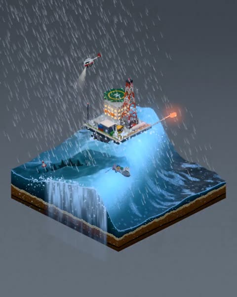

[← 返回图库](../browse/interactive.md) · [English](2116503955119255977.en.md)

# 暴风雨里的微缩钻井平台与巨兽

**[Jeroen van Welsenes · @Guronnimo](https://x.com/Guronnimo)** · 交互演示 · 24s

> 发现池 · 来源已核对，编目资料待完善。

**[▶ 打开画廊播放](https://guanmo-ai.github.io/awesome-ai-motion/#case-2116503955119255977)** · [作者原帖](https://x.com/Guronnimo/status/2116503955119255977)

点击封面打开画廊播放。

Three.js 微缩海面中，风雨、巨浪与钻井平台组成立体场景，随后加入巨兽制造尺度反差。

未取得作者公开提示词。 [查看作者原帖](https://x.com/Guronnimo/status/2116503955119255977)

收藏 — · 点赞 — · 浏览 —

## 来源记录

- 作品原帖: [@Guronnimo](https://x.com/Guronnimo/status/2116503955119255977) · 2026-10-31T12:14:00+00:00
- 模型归因: Claude Opus 5.5 · [作者说明](https://x.com/Guronnimo/status/2116503955119255977)
- 提示词查阅记录: [作者原帖](https://x.com/Guronnimo/status/2116503955119255977) · 2026-11-02 08:50 UTC
- 封面来源: [原帖封面来源](https://x.com/Guronnimo/status/2116503955119255977) · 4.82s
- 互动快照: [X 原帖](https://x.com/Guronnimo/status/2116503955119255977) · 2026-11-02 08:41 UTC
- 画廊原视频: [原帖媒体记录](https://x.com/Guronnimo/status/2116503955119255977) · 2026-11-02 08:50 UTC · 已核对原帖媒体对应与媒体响应；外部引用，不重新上传

模型依据来自作者自述，未独立重跑提示词，也未对音画作统一质量评级。视频引用作者原帖媒体，未由本站重新上传，转载许可未确认。
