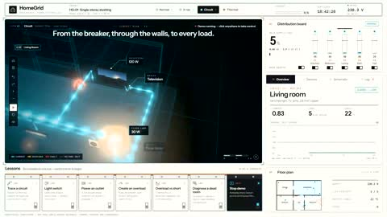

[← Back to gallery](../browse/education.en.md) · [简体中文](2116555241802105072.md)

# Interactive Lessons on Home Circuits and Breakers

**[Misato · @misat0x](https://x.com/misat0x)** · Education & explainers · 94s

> Discovery pool · Source verified; catalog details being completed.

**[▶ Open gallery to play](https://guanmo-ai.github.io/awesome-ai-motion/?lang=en#case-2116555241802105072)** · [Original post](https://x.com/misat0x/status/2116555241802105072)

Click the cover to open the gallery and play.

[Interactive home-circuit lesson](https://homegrid-deploy.vercel.app/)

Starting with tracing a circuit, animated diagrams connect overloads, short circuits and breaker operation.

## Source & web pages

- **Public web page**：[Interactive home-circuit lesson](https://homegrid-deploy.vercel.app/)
  [Link source](https://x.com/misat0x/status/2116555241802105072) · Link checked 2026-11-02 08:50 UTC

No public prompt has been verified. [View the original post](https://x.com/misat0x/status/2116555241802105072)

Bookmarks — · Likes — · Views —

## Source record

- Original post: [@misat0x](https://x.com/misat0x/status/2116555241802105072) · 2026-10-31T15:37:47+00:00
- Model attribution: Claude Opus 5.5 · [Creator’s statement](https://x.com/misat0x/status/2116555241802105072)
- Prompt lookup: [Creator post](https://x.com/misat0x/status/2116555241802105072) · 2026-11-02 08:50 UTC
- Cover source: [Original cover source](https://x.com/misat0x/status/2116555241802105072) · 18.89s
- Metrics snapshot: [Original X post](https://x.com/misat0x/status/2116555241802105072) · 2026-11-02 08:42 UTC
- Gallery video source: [Original post media record](https://x.com/misat0x/status/2116555241802105072) · 2026-11-02 08:50 UTC · Post/media correspondence and media response checked; external reference, no re-upload

Model attribution is based on creator statements. Prompts have not been independently rerun; sound and visuals have not received a uniform quality rating. Videos reference original post media, not our uploads; redistribution permission has not been verified.
