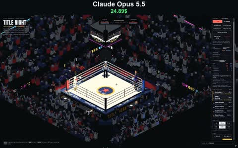

[← Back to gallery](../browse/interactive.en.md) · [简体中文](2116850100068553136.md)

# Pixel Boxing in a Multi-Camera Arena

**[NinjaCodex · @N1njaCodex](https://x.com/N1njaCodex)** · 3D & interactive · 17s

> Discovery pool · Source verified; catalog details being completed.

**[▶ Open gallery to play](https://guanmo-ai.github.io/awesome-ai-motion/?lang=en#case-2116850100068553136)** · [Original post](https://x.com/N1njaCodex/status/2116850100068553136)

Click the cover to open the gallery and play.

Pixel-style fighters, a referee and spectators fill a 3D boxing arena with changing cameras and live fight readings; this post shows the creator's Opus version.

No public prompt has been verified. [View the original post](https://x.com/N1njaCodex/status/2116850100068553136)

Bookmarks — · Likes — · Views —

## Source record

- Original post: [@N1njaCodex](https://x.com/N1njaCodex/status/2116850100068553136) · 2026-11-01T11:09:27+00:00
- Model attribution: Claude Opus 5.5 · [Creator’s statement](https://x.com/N1njaCodex/status/2116850100068553136)
- Prompt lookup: [Creator post](https://x.com/N1njaCodex/status/2116850100068553136) · 2026-11-02 08:50 UTC
- Cover source: [Original cover source](https://x.com/N1njaCodex/status/2116850100068553136) · 3.41s
- Metrics snapshot: [Original X post](https://x.com/N1njaCodex/status/2116850100068553136) · 2026-11-02 08:42 UTC
- Gallery video source: [Original post media record](https://x.com/N1njaCodex/status/2116850100068553136) · 2026-11-02 08:50 UTC · Post/media correspondence and media response checked; external reference, no re-upload

Model attribution is based on creator statements. Prompts have not been independently rerun; sound and visuals have not received a uniform quality rating. Videos reference original post media, not our uploads; redistribution permission has not been verified.
