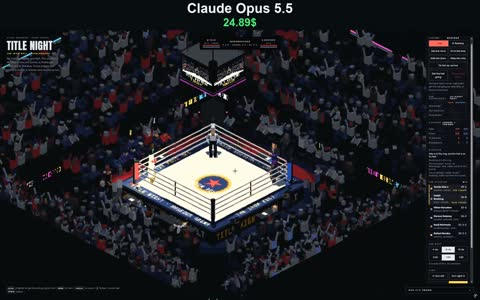

[← 返回图库](../browse/interactive.md) · [English](2116850100068553136.en.md)

# 像素拳击场的多机位对战

**[NinjaCodex · @N1njaCodex](https://x.com/N1njaCodex)** · 交互演示 · 17s

> 发现池 · 来源已核对，编目资料待完善。

**[▶ 打开画廊播放](https://guanmo-ai.github.io/awesome-ai-motion/#case-2116850100068553136)** · [作者原帖](https://x.com/N1njaCodex/status/2116850100068553136)

点击封面打开画廊播放。

像素风拳手、裁判与观众组成三维拳击场，多机位镜头配合实时比赛读数；本帖展示作者的 Opus 版本。

未取得作者公开提示词。 [查看作者原帖](https://x.com/N1njaCodex/status/2116850100068553136)

收藏 — · 点赞 — · 浏览 —

## 来源记录

- 作品原帖: [@N1njaCodex](https://x.com/N1njaCodex/status/2116850100068553136) · 2026-11-01T11:09:27+00:00
- 模型归因: Claude Opus 5.5 · [作者说明](https://x.com/N1njaCodex/status/2116850100068553136)
- 提示词查阅记录: [作者原帖](https://x.com/N1njaCodex/status/2116850100068553136) · 2026-11-02 08:50 UTC
- 封面来源: [原帖封面来源](https://x.com/N1njaCodex/status/2116850100068553136) · 3.41s
- 互动快照: [X 原帖](https://x.com/N1njaCodex/status/2116850100068553136) · 2026-11-02 08:42 UTC
- 画廊原视频: [原帖媒体记录](https://x.com/N1njaCodex/status/2116850100068553136) · 2026-11-02 08:50 UTC · 已核对原帖媒体对应与媒体响应；外部引用，不重新上传

模型依据来自作者自述，未独立重跑提示词，也未对音画作统一质量评级。视频引用作者原帖媒体，未由本站重新上传，转载许可未确认。
