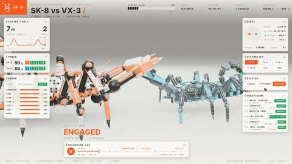

[← Back to gallery](../browse/interactive.en.md) · [简体中文](2116867442655814046.md)

# Two Mechanical Scorpions Fight and Disassemble

**[Specter · @sp3cterww](https://x.com/sp3cterww)** · 3D & interactive · 24s

> Discovery pool · Source verified; catalog details being completed.

**[▶ Open gallery to play](https://guanmo-ai.github.io/awesome-ai-motion/?lang=en#case-2116867442655814046)** · [Original post](https://x.com/sp3cterww/status/2116867442655814046)

Click the cover to open the gallery and play.

Two mechanical scorpions expose their claws and body mechanisms in combat, followed by a teardown with labels tracking the parts.

No public prompt has been verified. [View the original post](https://x.com/sp3cterww/status/2116867442655814046)

Bookmarks — · Likes — · Views —

## Source record

- Original post: [@sp3cterww](https://x.com/sp3cterww/status/2116867442655814046) · 2026-11-01T12:18:22+00:00
- Model attribution: Claude Opus 5.5 · [Creator’s statement](https://x.com/sp3cterww/status/2116867442655814046)
- Prompt lookup: [Creator post](https://x.com/sp3cterww/status/2116867442655814046) · 2026-11-02 08:50 UTC
- Cover source: [Original cover source](https://x.com/sp3cterww/status/2116867442655814046) · 4.81s
- Metrics snapshot: [Original X post](https://x.com/sp3cterww/status/2116867442655814046) · 2026-11-02 08:42 UTC
- Gallery video source: [Original post media record](https://x.com/sp3cterww/status/2116867442655814046) · 2026-11-02 08:50 UTC · Post/media correspondence and media response checked; external reference, no re-upload

Model attribution is based on creator statements. Prompts have not been independently rerun; sound and visuals have not received a uniform quality rating. Videos reference original post media, not our uploads; redistribution permission has not been verified.
