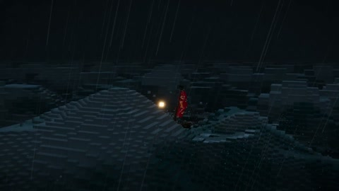

[← Back to gallery](../browse/interactive.en.md) · [简体中文](2116869601414045927.md)

# A Storm, Sea and Village in One HTML World

**[Adem Ninja · @halfofthemwork](https://x.com/halfofthemwork)** · 3D & interactive · 20s

> Discovery pool · Source verified; catalog details being completed.

**[▶ Open gallery to play](https://guanmo-ai.github.io/awesome-ai-motion/?lang=en#case-2116869601414045927)** · [Original post](https://x.com/halfofthemwork/status/2116869601414045927)

Click the cover to open the gallery and play.

Storm, sea and a village form a 3D short whose lightning reveals underwater details; the creator says the world is one HTML file.

No public prompt has been verified. [View the original post](https://x.com/halfofthemwork/status/2116869601414045927)

Bookmarks — · Likes — · Views —

## Source record

- Original post: [@halfofthemwork](https://x.com/halfofthemwork/status/2116869601414045927) · 2026-11-01T12:26:57+00:00
- Model attribution: Claude Opus 5.5 · [Creator’s statement](https://x.com/halfofthemwork/status/2116869601414045927)
- Prompt lookup: [Creator post](https://x.com/halfofthemwork/status/2116869601414045927) · 2026-11-02 08:50 UTC
- Cover source: [Original cover source](https://x.com/halfofthemwork/status/2116869601414045927) · 4s
- Metrics snapshot: [Original X post](https://x.com/halfofthemwork/status/2116869601414045927) · 2026-11-02 08:42 UTC
- Gallery video source: [Original post media record](https://x.com/halfofthemwork/status/2116869601414045927) · 2026-11-02 08:50 UTC · Post/media correspondence and media response checked; external reference, no re-upload

Model attribution is based on creator statements. Prompts have not been independently rerun; sound and visuals have not received a uniform quality rating. Videos reference original post media, not our uploads; redistribution permission has not been verified.
