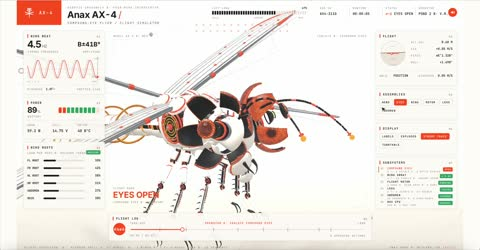

[← Back to gallery](../browse/interactive.en.md) · [简体中文](2116880857893838998.md)

# A Robotic Dragonfly Takes Flight and Comes Apart

**[Averix · @averix\_official](https://x.com/averix_official)** · 3D & interactive · 23s

> Discovery pool · Source verified; catalog details being completed.

**[▶ Open gallery to play](https://guanmo-ai.github.io/awesome-ai-motion/?lang=en#case-2116880857893838998)** · [Original post](https://x.com/averix_official/status/2116880857893838998)

Click the cover to open the gallery and play.

[General mechanical-teardown production skill](https://github.com/elvarofficial/teardown)

Sharp wing beats, eye shutters and shell motion reveal a robotic dragonfly before its parts separate in midair.

## Source & web pages

- **Related tool**：[General mechanical-teardown production skill](https://github.com/elvarofficial/teardown) · [MIT](https://github.com/elvarofficial/teardown/blob/main/LICENSE)
  A general tool linked by the production guide quoted in the post; it is not the complete project for this film.
  [Link source](https://x.com/elvar_official/status/2116174609355571402) · Link checked 2026-11-02 08:50 UTC

## What to learn

Compare still renders with the reference before animating, fixing the silhouette, optics and readable wing beats.

**Try it yourself** · Editorial suggestions based on public source material, not a complete record of the creator’s process.

1. Script the shell and internal machinery.
2. Compare with the reference and revise glow, wing trails and proportions.
3. Then stage takeoff, eye shutters and the teardown.

Tools mentioned in the source：Opus 5.5 · Blender

[Source 1](https://x.com/averix_official/status/2116880857893838998)

No public prompt has been verified. [View the original post](https://x.com/averix_official/status/2116880857893838998)

Bookmarks — · Likes — · Views —

## Source record

- Original post: [@averix\_official](https://x.com/averix_official/status/2116880857893838998) · 2026-11-01T13:11:40+00:00
- Model attribution: Claude Opus 5.5 · [Creator’s statement](https://x.com/averix_official/status/2116880857893838998)
- Prompt lookup: [Creator post](https://x.com/averix_official/status/2116880857893838998) · 2026-11-02 08:50 UTC
- Cover source: [Original cover source](https://x.com/averix_official/status/2116880857893838998) · 4.62s
- Metrics snapshot: [Original X post](https://x.com/averix_official/status/2116880857893838998) · 2026-11-02 08:42 UTC
- Gallery video source: [Original post media record](https://x.com/averix_official/status/2116880857893838998) · 2026-11-02 08:50 UTC · Post/media correspondence and media response checked; external reference, no re-upload

Model attribution is based on creator statements. Prompts have not been independently rerun; sound and visuals have not received a uniform quality rating. Videos reference original post media, not our uploads; redistribution permission has not been verified.
