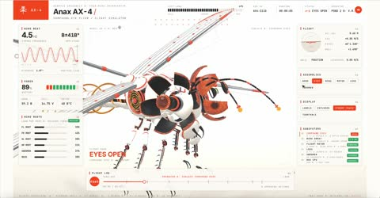

[← 返回图库](../browse/interactive.md) · [English](2116880857893838998.en.md)

# 机械蜻蜓起飞与零件展开

**[Averix · @averix\_official](https://x.com/averix_official)** · 交互演示 · 23s

> 发现池 · 来源已核对，编目资料待完善。

**[▶ 打开画廊播放](https://guanmo-ai.github.io/awesome-ai-motion/#case-2116880857893838998)** · [作者原帖](https://x.com/averix_official/status/2116880857893838998)

点击封面打开画廊播放。

[机械拆解通用制作 Skill](https://github.com/elvarofficial/teardown)

机械蜻蜓以清晰的振翅、眼部快门和外壳运动展示结构，随后在空中拆开零件。

## 源码与网页

- **相关工具**：[机械拆解通用制作 Skill](https://github.com/elvarofficial/teardown) · [MIT](https://github.com/elvarofficial/teardown/blob/main/LICENSE)
  原帖引用的制作方法所链接的通用工具；不等同于这支影片的完整工程。
  [链接出处](https://x.com/elvar_official/status/2116174609355571402) · 链接核对 2026-11-02 08:50 UTC

## 可以借鉴什么

在动画前先比较静帧与参考，修正轮廓、眼部和振翅的可读性。

**开始尝试** · 根据作者公开资料整理的编辑建议，并非作者完整操作记录。

1. 先用脚本搭出外壳与内部机械结构。
2. 对照参考修正泛光、翅膀拖影和身体比例。
3. 再安排起飞、眼部快门与零件拆解。

原文提到的工具：Opus 5.5 · Blender

[资料出处 1](https://x.com/averix_official/status/2116880857893838998)

未取得作者公开提示词。 [查看作者原帖](https://x.com/averix_official/status/2116880857893838998)

收藏 — · 点赞 — · 浏览 —

## 来源记录

- 作品原帖: [@averix\_official](https://x.com/averix_official/status/2116880857893838998) · 2026-11-01T13:11:40+00:00
- 模型归因: Claude Opus 5.5 · [作者说明](https://x.com/averix_official/status/2116880857893838998)
- 提示词查阅记录: [作者原帖](https://x.com/averix_official/status/2116880857893838998) · 2026-11-02 08:50 UTC
- 封面来源: [原帖封面来源](https://x.com/averix_official/status/2116880857893838998) · 4.62s
- 互动快照: [X 原帖](https://x.com/averix_official/status/2116880857893838998) · 2026-11-02 08:42 UTC
- 画廊原视频: [原帖媒体记录](https://x.com/averix_official/status/2116880857893838998) · 2026-11-02 08:50 UTC · 已核对原帖媒体对应与媒体响应；外部引用，不重新上传

模型依据来自作者自述，未独立重跑提示词，也未对音画作统一质量评级。视频引用作者原帖媒体，未由本站重新上传，转载许可未确认。
