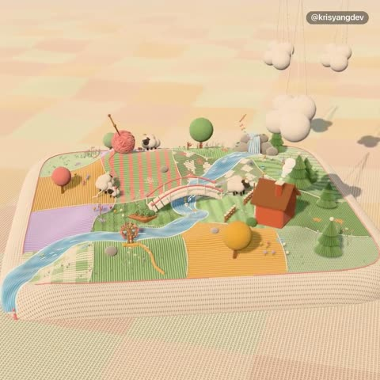

[← 返回图库](../browse/interactive.md) · [English](2116887799274299512.en.md)

# 一根线织出整座岛屿

**[Kris Yang · @krisyangdev](https://x.com/krisyangdev)** · 交互演示 · 15s

> 发现池 · 来源已核对，编目资料待完善。

**[▶ 打开画廊播放](https://guanmo-ai.github.io/awesome-ai-motion/#case-2116887799274299512)** · [作者原帖](https://x.com/krisyangdev/status/2116887799274299512)

点击封面打开画廊播放。

拖动线头触发岛屿编织，针脚、地形与装饰逐步出现；作者声明针脚由代码生成，不依赖图像纹理。

未取得作者公开提示词。 [查看作者原帖](https://x.com/krisyangdev/status/2116887799274299512)

收藏 — · 点赞 — · 浏览 —

## 来源记录

- 作品原帖: [@krisyangdev](https://x.com/krisyangdev/status/2116887799274299512) · 2026-11-01T13:39:15+00:00
- 模型归因: Claude Opus 5.5 · [作者说明](https://x.com/krisyangdev/status/2116887799274299512)
- 提示词查阅记录: [作者原帖](https://x.com/krisyangdev/status/2116887799274299512) · 2026-11-02 08:50 UTC
- 封面来源: [原帖封面来源](https://x.com/krisyangdev/status/2116887799274299512) · 10.54s
- 互动快照: [X 原帖](https://x.com/krisyangdev/status/2116887799274299512) · 2026-11-02 08:42 UTC
- 画廊原视频: [原帖媒体记录](https://x.com/krisyangdev/status/2116887799274299512) · 2026-11-02 08:50 UTC · 已核对原帖媒体对应与媒体响应；外部引用，不重新上传

模型依据来自作者自述，未独立重跑提示词，也未对音画作统一质量评级。视频引用作者原帖媒体，未由本站重新上传，转载许可未确认。
