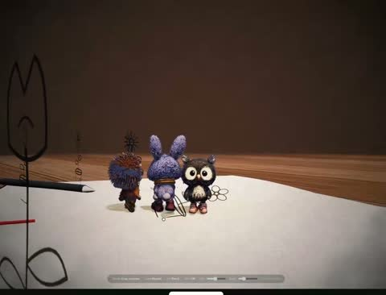

[← Back to gallery](../browse/characters.en.md) · [简体中文](2117069916121817591.md)

# Paper Characters Enter a 3D World

**[Chetan Ankola · @chetanankola](https://x.com/chetanankola)** · Pixel art & characters · 16s

> Discovery pool · Source verified; catalog details being completed.

**[▶ Open gallery to play](https://guanmo-ai.github.io/awesome-ai-motion/?lang=en#case-2117069916121817591)** · [Original post](https://x.com/chetanankola/status/2117069916121817591)

Click the cover to open the gallery and play.

Character sketches on paper become small 3D figures on a desk as the camera moves between drawings and models, credited to Three.js, Blender and Opus 5.5.

No public prompt has been verified. [View the original post](https://x.com/chetanankola/status/2117069916121817591)

Bookmarks — · Likes — · Views —

## Source record

- Original post: [@chetanankola](https://x.com/chetanankola/status/2117069916121817591) · 2026-11-02T01:42:55.000Z
- Model attribution: Claude Opus 5.5 · [Creator’s statement](https://x.com/chetanankola/status/2117069916121817591)
- Prompt lookup: [Creator post](https://x.com/chetanankola/status/2117069916121817591) · 2026-11-06 17:34 UTC
- Cover source: [Original cover source](https://x.com/chetanankola/status/2117069916121817591) · 3.2s
- Metrics snapshot: [Original X post](https://x.com/chetanankola/status/2117069916121817591) · 2026-11-06 17:22 UTC
- Gallery video source: [Original post media record](https://x.com/chetanankola/status/2117069916121817591) · 2026-11-06 17:34 UTC · Post/media correspondence and media response checked; external reference, no re-upload

Model attribution is based on creator statements. Prompts have not been independently rerun; sound and visuals have not received a uniform quality rating. Videos reference original post media, not our uploads; redistribution permission has not been verified.
