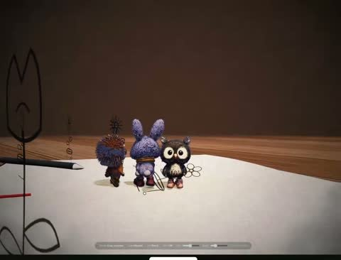

[← 返回图库](../browse/characters.md) · [English](2117069916121817591.en.md)

# 纸面角色走入三维世界

**[Chetan Ankola · @chetanankola](https://x.com/chetanankola)** · 角色动画 · 16s

> 发现池 · 来源已核对，编目资料待完善。

**[▶ 打开画廊播放](https://guanmo-ai.github.io/awesome-ai-motion/#case-2117069916121817591)** · [作者原帖](https://x.com/chetanankola/status/2117069916121817591)

点击封面打开画廊播放。

纸张上的角色草图转成桌面三维小角色，镜头在笔迹与模型之间移动；作者说明使用 Three.js、Blender 与 Opus 5.5。

未取得作者公开提示词。 [查看作者原帖](https://x.com/chetanankola/status/2117069916121817591)

收藏 — · 点赞 — · 浏览 —

## 来源记录

- 作品原帖: [@chetanankola](https://x.com/chetanankola/status/2117069916121817591) · 2026-11-02T01:42:55.000Z
- 模型归因: Claude Opus 5.5 · [作者说明](https://x.com/chetanankola/status/2117069916121817591)
- 提示词查阅记录: [作者原帖](https://x.com/chetanankola/status/2117069916121817591) · 2026-11-06 17:34 UTC
- 封面来源: [原帖封面来源](https://x.com/chetanankola/status/2117069916121817591) · 3.2s
- 互动快照: [X 原帖](https://x.com/chetanankola/status/2117069916121817591) · 2026-11-06 17:22 UTC
- 画廊原视频: [原帖媒体记录](https://x.com/chetanankola/status/2117069916121817591) · 2026-11-06 17:34 UTC · 已核对原帖媒体对应与媒体响应；外部引用，不重新上传

模型依据来自作者自述，未独立重跑提示词，也未对音画作统一质量评级。视频引用作者原帖媒体，未由本站重新上传，转载许可未确认。
