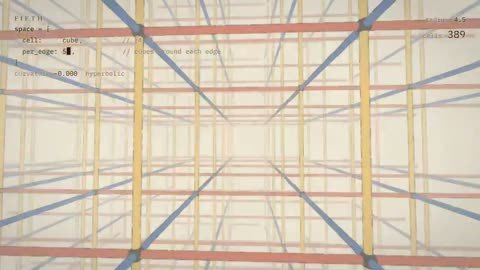

[← Back to gallery](../browse/interactive.en.md) · [简体中文](2117580663759273988.md)

# FIFTH: Rooms That Bend Space

**[Charlotte · @Charlotteqozf](https://x.com/Charlotteqozf)** · 3D & interactive · 68s

> Discovery pool · Source verified; catalog details being completed.

**[▶ Open gallery to play](https://guanmo-ai.github.io/awesome-ai-motion/?lang=en#case-2117580663759273988)** · [Original post](https://x.com/Charlotteqozf/status/2117580663759273988)

Click the cover to open the gallery and play.

Grid rooms and polyhedral cells change as different numbers meet around an edge, creating a non-Euclidean journey credited to Opus 5.5.

No public prompt has been verified. [View the original post](https://x.com/Charlotteqozf/status/2117580663759273988)

Bookmarks — · Likes — · Views —

## Source record

- Original post: [@Charlotteqozf](https://x.com/Charlotteqozf/status/2117580663759273988) · 2026-11-03T11:32:27.000Z
- Model attribution: Claude Opus 5.5 · [Creator’s statement](https://x.com/Charlotteqozf/status/2117580663759273988)
- Prompt lookup: [Creator post](https://x.com/Charlotteqozf/status/2117580663759273988) · 2026-11-06 17:34 UTC
- Cover source: [Original cover source](https://x.com/Charlotteqozf/status/2117580663759273988) · 13.65s
- Metrics snapshot: [Original X post](https://x.com/Charlotteqozf/status/2117580663759273988) · 2026-11-06 17:22 UTC
- Gallery video source: [Original post media record](https://x.com/Charlotteqozf/status/2117580663759273988) · 2026-11-06 17:34 UTC · Post/media correspondence and media response checked; external reference, no re-upload

Model attribution is based on creator statements. Prompts have not been independently rerun; sound and visuals have not received a uniform quality rating. Videos reference original post media, not our uploads; redistribution permission has not been verified.
