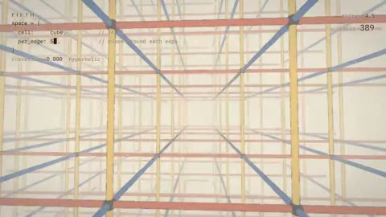

[← 返回图库](../browse/interactive.md) · [English](2117580663759273988.en.md)

# FIFTH：房间如何弯曲空间

**[Charlotte · @Charlotteqozf](https://x.com/Charlotteqozf)** · 交互演示 · 68s

> 发现池 · 来源已核对，编目资料待完善。

**[▶ 打开画廊播放](https://guanmo-ai.github.io/awesome-ai-motion/#case-2117580663759273988)** · [作者原帖](https://x.com/Charlotteqozf/status/2117580663759273988)

点击封面打开画廊播放。

网格房间与多面体空间随每条边聚合的单元数变化，形成非欧几何穿行；作者说明这是 Opus 5.5 制作的短版。

未取得作者公开提示词。 [查看作者原帖](https://x.com/Charlotteqozf/status/2117580663759273988)

收藏 — · 点赞 — · 浏览 —

## 来源记录

- 作品原帖: [@Charlotteqozf](https://x.com/Charlotteqozf/status/2117580663759273988) · 2026-11-03T11:32:27.000Z
- 模型归因: Claude Opus 5.5 · [作者说明](https://x.com/Charlotteqozf/status/2117580663759273988)
- 提示词查阅记录: [作者原帖](https://x.com/Charlotteqozf/status/2117580663759273988) · 2026-11-06 17:34 UTC
- 封面来源: [原帖封面来源](https://x.com/Charlotteqozf/status/2117580663759273988) · 13.65s
- 互动快照: [X 原帖](https://x.com/Charlotteqozf/status/2117580663759273988) · 2026-11-06 17:22 UTC
- 画廊原视频: [原帖媒体记录](https://x.com/Charlotteqozf/status/2117580663759273988) · 2026-11-06 17:34 UTC · 已核对原帖媒体对应与媒体响应；外部引用，不重新上传

模型依据来自作者自述，未独立重跑提示词，也未对音画作统一质量评级。视频引用作者原帖媒体，未由本站重新上传，转载许可未确认。
