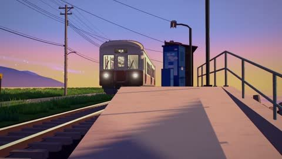

[← Back to gallery](../browse/stories.en.md) · [简体中文](2117680088364016090.md)

# The Last Train to the Galaxy

**[Jay Patel · @jayypatel18](https://x.com/jayypatel18)** · Narrative films · 90s

> Discovery pool · Source verified; catalog details being completed.

**[▶ Open gallery to play](https://guanmo-ai.github.io/awesome-ai-motion/?lang=en#case-2117680088364016090)** · [Original post](https://x.com/jayypatel18/status/2117680088364016090)

Click the cover to open the gallery and play.

[Shot-by-shot code and synthesized soundtrack project](https://github.com/jayypatel18/last-train) · [Watch the train short in a browser](https://jayypatel18.github.io/last-train/)

An empty seaside station receives an old railcar before its tracks rise into clouds and the Milky Way. The creator shares the Opus 5.5 project, prompt and browser demo.

## Source & web pages

- **Direct source**：[Shot-by-shot code and synthesized soundtrack project](https://github.com/jayypatel18/last-train) · No license specified
  The project is directly linked by the creator. No overall license was found; the Three.js MIT license only covers that dependency.
  [Link source](https://x.com/jayypatel18/status/2117680088364016090) · Link checked 2026-11-06 17:34 UTC
- **Public web page**：[Watch the train short in a browser](https://jayypatel18.github.io/last-train/)
  [Link source](https://x.com/jayypatel18/status/2117680088364016090) · Link checked 2026-11-06 17:34 UTC

The creator has shared instructions; this catalog links to the source without redistributing the full text or translation. [Read the creator’s original](https://x.com/jayypatel18/status/2117680088364016090)

Bookmarks — · Likes — · Views —

## Source record

- Original post: [@jayypatel18](https://x.com/jayypatel18/status/2117680088364016090) · 2026-11-03T18:07:32.000Z
- Model attribution: Claude Opus 5.5 · [Creator’s statement](https://x.com/jayypatel18/status/2117680088364016090)
- Prompt source: [Creator post](https://x.com/jayypatel18/status/2117680088364016090) · 2026-11-06 17:34 UTC
- Cover source: [Original cover source](https://x.com/jayypatel18/status/2117680088364016090) · 18.03s
- Metrics snapshot: [Original X post](https://x.com/jayypatel18/status/2117680088364016090) · 2026-11-06 17:22 UTC
- Gallery video source: [Original post media record](https://x.com/jayypatel18/status/2117680088364016090) · 2026-11-06 17:34 UTC · Post/media correspondence and media response checked; external reference, no re-upload

Model attribution is based on creator statements. Prompts have not been independently rerun; sound and visuals have not received a uniform quality rating. Videos reference original post media, not our uploads; redistribution permission has not been verified.
