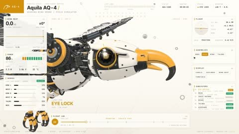

[← Back to gallery](../browse/interactive.en.md) · [简体中文](2118438787227484294.md)

# A Robot Eagle's Zoom Eye and Detachable Wings

**[Averix · @averix\_official](https://x.com/averix_official)** · 3D & interactive · 15s

> Discovery pool · Source verified; catalog details being completed.

**[▶ Open gallery to play](https://guanmo-ai.github.io/awesome-ai-motion/?lang=en#case-2118438787227484294)** · [Original post](https://x.com/averix_official/status/2118438787227484294)

Click the cover to open the gallery and play.

A gold iris and telescoping lens lock on before feathers, talons and body panels open, in a robotic eagle the creator asked Opus 5.5 to build.

No public prompt has been verified. [View the original post](https://x.com/averix_official/status/2118438787227484294)

Bookmarks — · Likes — · Views —

## Source record

- Original post: [@averix\_official](https://x.com/averix_official/status/2118438787227484294) · 2026-11-05T20:22:20.000Z
- Model attribution: Claude Opus 5.5 · [Creator’s statement](https://x.com/averix_official/status/2118438787227484294)
- Prompt lookup: [Creator post](https://x.com/averix_official/status/2118438787227484294) · 2026-11-06 17:34 UTC
- Cover source: [Original cover source](https://x.com/averix_official/status/2118438787227484294) · 3.01s
- Metrics snapshot: [Original X post](https://x.com/averix_official/status/2118438787227484294) · 2026-11-06 17:22 UTC
- Gallery video source: [Original post media record](https://x.com/averix_official/status/2118438787227484294) · 2026-11-06 17:34 UTC · Post/media correspondence and media response checked; external reference, no re-upload

Model attribution is based on creator statements. Prompts have not been independently rerun; sound and visuals have not received a uniform quality rating. Videos reference original post media, not our uploads; redistribution permission has not been verified.
