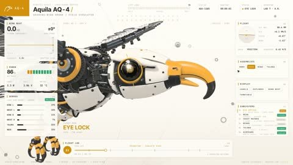

[← 返回图库](../browse/interactive.md) · [English](2118438787227484294.en.md)

# 机械鹰的变焦眼与拆翼

**[Averix · @averix\_official](https://x.com/averix_official)** · 交互演示 · 15s

> 发现池 · 来源已核对，编目资料待完善。

**[▶ 打开画廊播放](https://guanmo-ai.github.io/awesome-ai-motion/#case-2118438787227484294)** · [作者原帖](https://x.com/averix_official/status/2118438787227484294)

点击封面打开画廊播放。

金色虹膜与伸缩镜头完成锁定，翼片、爪部与机身随后依次展开；作者明确说明让 Opus 5.5 制作这只机械鹰。

未取得作者公开提示词。 [查看作者原帖](https://x.com/averix_official/status/2118438787227484294)

收藏 — · 点赞 — · 浏览 —

## 来源记录

- 作品原帖: [@averix\_official](https://x.com/averix_official/status/2118438787227484294) · 2026-11-05T20:22:20.000Z
- 模型归因: Claude Opus 5.5 · [作者说明](https://x.com/averix_official/status/2118438787227484294)
- 提示词查阅记录: [作者原帖](https://x.com/averix_official/status/2118438787227484294) · 2026-11-06 17:34 UTC
- 封面来源: [原帖封面来源](https://x.com/averix_official/status/2118438787227484294) · 3.01s
- 互动快照: [X 原帖](https://x.com/averix_official/status/2118438787227484294) · 2026-11-06 17:22 UTC
- 画廊原视频: [原帖媒体记录](https://x.com/averix_official/status/2118438787227484294) · 2026-11-06 17:34 UTC · 已核对原帖媒体对应与媒体响应；外部引用，不重新上传

模型依据来自作者自述，未独立重跑提示词，也未对音画作统一质量评级。视频引用作者原帖媒体，未由本站重新上传，转载许可未确认。
