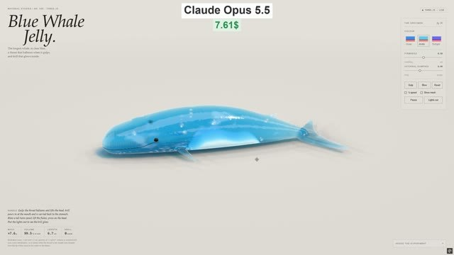

[← Back to gallery](../browse/interactive.en.md) · [简体中文](2119542001775628299.md)

# Blue Whale Jelly: A Transparent Whale Deforms

**[Vib3Coded · @vib3coded](https://x.com/vib3coded)** · 3D & interactive · 17s

> Discovery pool · Source verified; catalog details being completed.

**[▶ Open gallery to play](https://guanmo-ai.github.io/awesome-ai-motion/?lang=en#case-2119542001775628299)** · [Original post](https://x.com/vib3coded/status/2119542001775628299)

Click the cover to open the gallery and play.

A transparent blue whale stretches, bends and releases as internal details and highlights follow its soft shape. The creator credits Opus 5.5.

No public prompt has been verified. [View the original post](https://x.com/vib3coded/status/2119542001775628299)

Bookmarks — · Likes — · Views —

## Source record

- Original post: [@vib3coded](https://x.com/vib3coded/status/2119542001775628299) · 2026-11-08T21:26:07.000Z
- Model attribution: Claude Opus 5.5 · [Creator’s statement](https://x.com/vib3coded/status/2119542001775628299)
- Prompt lookup: [Creator post](https://x.com/vib3coded/status/2119542001775628299) · 2026-11-15 05:51 UTC
- Cover source: [Original cover source](https://x.com/vib3coded/status/2119542001775628299) · 3.75s
- Metrics snapshot: [Original X post](https://x.com/vib3coded/status/2119542001775628299) · 2026-11-15 05:51 UTC
- Gallery video source: [Original post media record](https://x.com/vib3coded/status/2119542001775628299) · 2026-11-15 05:59 UTC · Post/media correspondence and media response checked; external reference, no re-upload

Model attribution is based on creator statements. Prompts have not been independently rerun; sound and visuals have not received a uniform quality rating. Videos reference original post media, not our uploads; redistribution permission has not been verified.
