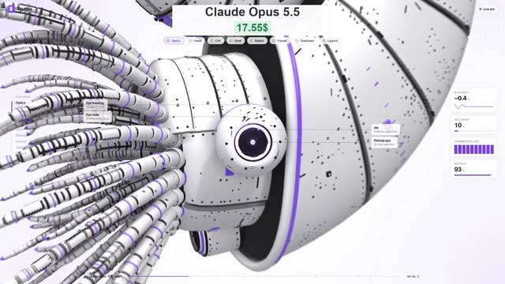

[← Back to gallery](../browse/interactive.en.md) · [简体中文](2119748934809567640.md)

# A Mechanical Nautilus: Tentacles, Spiral Shell and Exploded View

**[Vib3Coded · @vib3coded](https://x.com/vib3coded)** · 3D & interactive · 15s

> Discovery pool · Source verified; catalog details being completed.

**[▶ Open gallery to play](https://guanmo-ai.github.io/awesome-ai-motion/?lang=en#case-2119748934809567640)** · [Original post](https://x.com/vib3coded/status/2119748934809567640)

Click the cover to open the gallery and play.

Tentacles and shell sections separate along a spiral structure before an exploded view reveals the internals. The creator credits Opus 5.5 with all geometry in code.

No public prompt has been verified. [View the original post](https://x.com/vib3coded/status/2119748934809567640)

Bookmarks — · Likes — · Views —

## Source record

- Original post: [@vib3coded](https://x.com/vib3coded/status/2119748934809567640) · 2026-11-09T11:08:23.000Z
- Model attribution: Claude Opus 5.5 · [Creator’s statement](https://x.com/vib3coded/status/2119748934809567640)
- Prompt lookup: [Creator post](https://x.com/vib3coded/status/2119748934809567640) · 2026-11-15 05:51 UTC
- Cover source: [Original cover source](https://x.com/vib3coded/status/2119748934809567640) · 3.313s
- Metrics snapshot: [Original X post](https://x.com/vib3coded/status/2119748934809567640) · 2026-11-15 05:51 UTC
- Gallery video source: [Original post media record](https://x.com/vib3coded/status/2119748934809567640) · 2026-11-15 05:59 UTC · Post/media correspondence and media response checked; external reference, no re-upload

Model attribution is based on creator statements. Prompts have not been independently rerun; sound and visuals have not received a uniform quality rating. Videos reference original post media, not our uploads; redistribution permission has not been verified.
