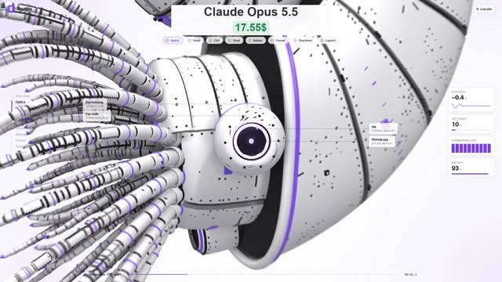

[← 返回图库](../browse/interactive.md) · [English](2119748934809567640.en.md)

# 机械鹦鹉螺：触腕、螺旋壳与爆炸图

**[Vib3Coded · @vib3coded](https://x.com/vib3coded)** · 交互演示 · 15s

> 发现池 · 来源已核对，编目资料待完善。

**[▶ 打开画廊播放](https://guanmo-ai.github.io/awesome-ai-motion/#case-2119748934809567640)** · [作者原帖](https://x.com/vib3coded/status/2119748934809567640)

点击封面打开画廊播放。

触腕与外壳沿螺旋结构分层展开，再以爆炸图展示内部组件，运动围绕壳体几何组织。作者称全部几何由 Opus 5.5 以代码生成。

未取得作者公开提示词。 [查看作者原帖](https://x.com/vib3coded/status/2119748934809567640)

收藏 — · 点赞 — · 浏览 —

## 来源记录

- 作品原帖: [@vib3coded](https://x.com/vib3coded/status/2119748934809567640) · 2026-11-09T11:08:23.000Z
- 模型归因: Claude Opus 5.5 · [作者说明](https://x.com/vib3coded/status/2119748934809567640)
- 提示词查阅记录: [作者原帖](https://x.com/vib3coded/status/2119748934809567640) · 2026-11-15 05:51 UTC
- 封面来源: [原帖封面来源](https://x.com/vib3coded/status/2119748934809567640) · 3.313s
- 互动快照: [X 原帖](https://x.com/vib3coded/status/2119748934809567640) · 2026-11-15 05:51 UTC
- 画廊原视频: [原帖媒体记录](https://x.com/vib3coded/status/2119748934809567640) · 2026-11-15 05:59 UTC · 已核对原帖媒体对应与媒体响应；外部引用，不重新上传

模型依据来自作者自述，未独立重跑提示词，也未对音画作统一质量评级。视频引用作者原帖媒体，未由本站重新上传，转载许可未确认。
