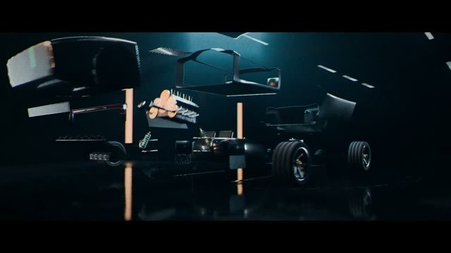

[← Back to gallery](../browse/stories.en.md) · [简体中文](2119848812202369120.md)

# A Python-Coded Journey Through Cars, Canyons and Temples

**[Zeyko · @iZeykoai](https://x.com/iZeykoai)** · Narrative films · 37s

> Discovery pool · Source verified; catalog details being completed.

**[▶ Open gallery to play](https://guanmo-ai.github.io/awesome-ai-motion/?lang=en#case-2119848812202369120)** · [Original post](https://x.com/iZeykoai/status/2119848812202369120)

Click the cover to open the gallery and play.

Mechanical parts give way to a canyon road and temple entrance through forward-moving camera shots. The creator credits Opus 5.5 with Python-generated frames and no 3D assets.

No public prompt has been verified. [View the original post](https://x.com/iZeykoai/status/2119848812202369120)

Bookmarks — · Likes — · Views —

## Source record

- Original post: [@iZeykoai](https://x.com/iZeykoai/status/2119848812202369120) · 2026-11-09T17:45:16.000Z
- Model attribution: Claude Opus 5.5 · [Creator’s statement](https://x.com/iZeykoai/status/2119848812202369120)
- Prompt lookup: [Creator post](https://x.com/iZeykoai/status/2119848812202369120) · 2026-11-15 05:51 UTC
- Cover source: [Original cover source](https://x.com/iZeykoai/status/2119848812202369120) · 8.049s
- Metrics snapshot: [Original X post](https://x.com/iZeykoai/status/2119848812202369120) · 2026-11-15 05:51 UTC
- Gallery video source: [Original post media record](https://x.com/iZeykoai/status/2119848812202369120) · 2026-11-15 05:59 UTC · Post/media correspondence and media response checked; external reference, no re-upload

Model attribution is based on creator statements. Prompts have not been independently rerun; sound and visuals have not received a uniform quality rating. Videos reference original post media, not our uploads; redistribution permission has not been verified.
